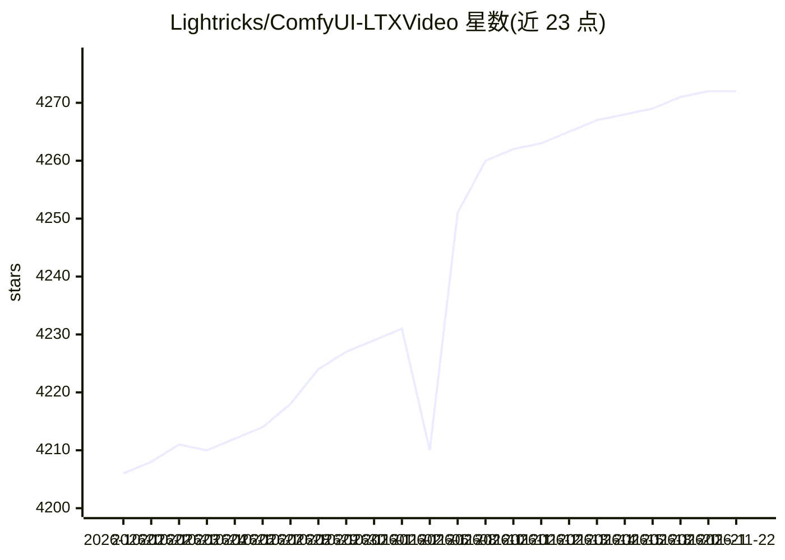

# Lightricks/ComfyUI-LTXVideo

⭐ 4,272 · Python · NOASSERTION · 推送 2026-11-12 · [GitHub](https://github.com/Lightricks/ComfyUI-LTXVideo) · [官网](https://ltx.io/model/ltx-2) · 组织维护

**为 ComfyUI 扩展 LTX-2 视频/音频生成的自定义节点集合**

面向 ComfyUI 用户的 LTX-2 模型扩展节点包：提供文生视频、图生视频、视频转视频、拼接式 Tiled Fusion 大画布采样以及纯文本生成音频的节点与示例工作流，并附带 Union IC-LoRA、HDR 升级、Dub-It 配音换语、像素空间放大等多组 LoRA 的下载清单。LTX-2 已内置于 ComfyUI 核心，本仓库提供额外节点；通过 ComfyUI Manager 安装，需 CUDA GPU 与约 32GB 显存、100GB 磁盘空间，低显存系统可用专用加载节点做模型卸载。

## 筛选速览

| 维度 | 判定 | 备注 |
|---|---|---|
| AI 角色 | `ai-native` | 本体是模型或模型工具 |
| 许可风险 | `none` | NOASSERTION |
| 部署形态 | `None` |  |
| 模型依赖 | — | README 未给出锁定关系 |
| 硬件要求 | `gpu-24g` | |
| 安装摩擦 | `medium` | 含编译或系统依赖之一 |
| 成熟度 | — | 结构信号不足 |

## 能力要点

- 提供 LTX-2.3 全模型/蒸馏模型、IC-LoRA 控制等多套示例工作流
- Union IC-LoRA 将 depth 与 edge 控制条件合并为单一 LoRA 并降低显存占用
- 支持 HDR（ACEScct/LogC3）输出与 16-bit EXR 序列导出
- Dub-It 支持多语言配音与同语改写，保持说话人身份

## 适用场景

- 在 ComfyUI 中用文本或图片生成视频
- 对已有视频做上采样、HDR 调色或配音换语
- 纯文本生成音频且不输出视频

## 场景标签

`视频生成` · 领域:内容生成

## 证据(README 行号)

> L11: A collection of powerful custom nodes that extend ComfyUI's capabilities for the LTX-2 video generation model.
> L48: * `Text/image to video full/distilled model; single stage`
> L116: LTX-2 is a single joint audio/video transformer, but it can generate audio on its own. The `LTXVAudioOnlyModel` no

## 星数曲线

2026-10-20 4,206 → 2026-11-22 4,272（+66）

---
*卡片 v1 · prompt 1.4 · 生成 2026-11-22 · 置信度 high · 依据 README sha `58fb833dd3f6` · [字段定义](../../DATASET.md)*
