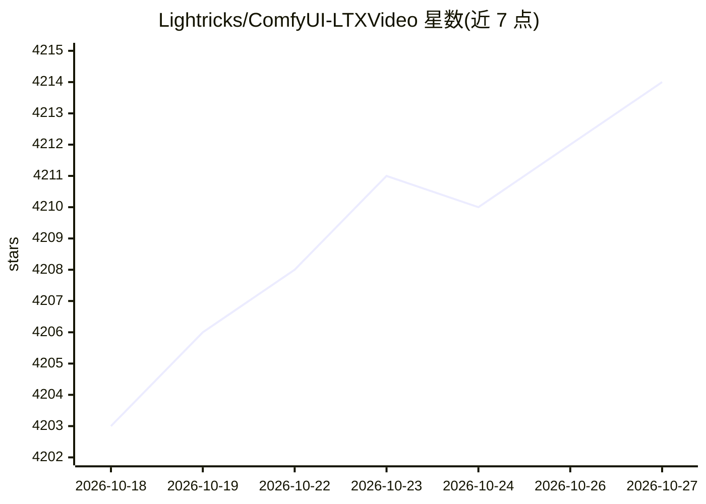

# Lightricks/ComfyUI-LTXVideo

⭐ 4,214 · Python · NOASSERTION · 推送 2026-10-20 · [GitHub](https://github.com/Lightricks/ComfyUI-LTXVideo) · [官网](https://ltx.io/model/ltx-2) · 组织维护

**为 ComfyUI 提供 LTX-2 视频生成模型的自定义节点集合**

Lightricks 维护的 ComfyUI 自定义节点仓库，扩展 ComfyUI 对 LTX-2 视频/音频生成模型的使用：提供文生视频、图生视频、视频重绘、IC-LoRA 控制（深度/边缘/姿态/HDR/配音）、2×/4× 生成式上采样、纯文本生音频等示例工作流，以及 Tiled Fusion Sampler 与低显存加载节点。要求 ComfyUI、CUDA 兼容 GPU（32GB+ 显存）与 100GB+ 磁盘，需手动下载模型文件到对应目录。通过 Comfy Manager 安装。

## 筛选速览

| 维度 | 判定 | 备注 |
|---|---|---|
| AI 角色 | `ai-ecosystem` | LLM/agent 周边工具 |
| 许可风险 | `none` | NOASSERTION |
| 部署形态 | `library` | 以包/库形式分发 |
| 模型依赖 | — | README 未给出锁定关系 |
| 硬件要求 | `gpu-24g` | |
| 安装摩擦 | `medium` | 含编译或系统依赖之一 |
| 成熟度 | — | 结构信号不足 |

## 能力要点

- LTX-2 文/图生视频与文生音频的示例工作流集合
- Union IC-LoRA 将深度与边缘控制合并为单一 LoRA
- Dub-It IC-LoRA 支持多语言配音与同语言改写
- Tiled Fusion Sampler 支持超训练窗口的大画布去噪（FullHD/4K/8K）

## 适用场景

- 在 ComfyUI 中用 LTX-2 生成或编辑视频
- 用 IC-LoRA 按深度/姿态/边缘控制视频生成
- 对低分辨率视频做 2×/4× 生成式上采样
- 用文本提示独立生成音频

## 场景标签

`视频生成` · 领域:内容生成

## 证据(README 行号)

> L11: A collection of powerful custom nodes that extend ComfyUI's capabilities for the LTX-2 video generation model.
> L13: LTX-2 is built into ComfyUI core (see it here), making it readily accessible to all ComfyUI users. This repository 

## 星数曲线

2026-10-18 4,203 → 2026-10-27 4,214（+11）

---
*卡片 v1 · prompt 1.4 · 生成 2026-10-20 · 置信度 mid · 依据 README sha `ed2733427263` · [字段定义](../../DATASET.md)*
