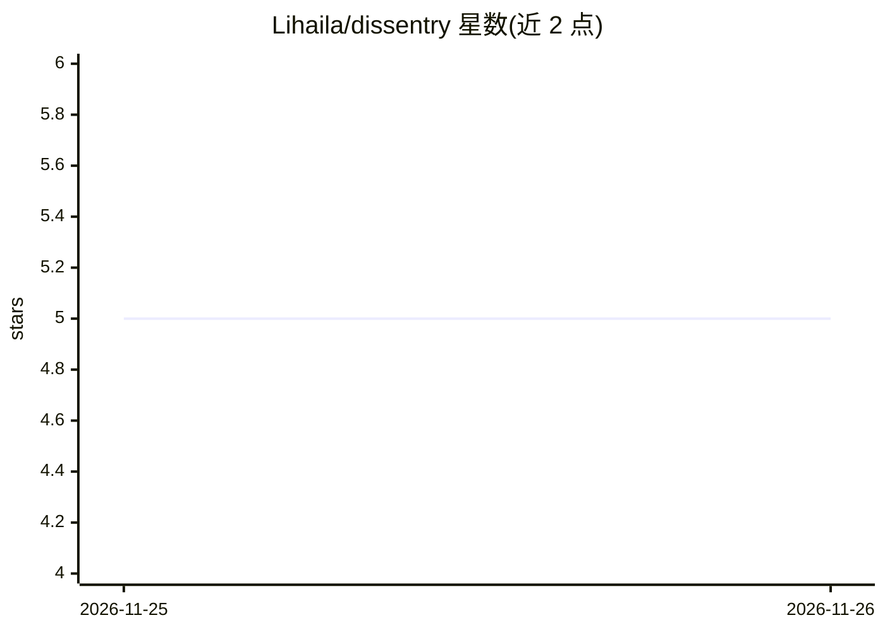

# Lihaila/dissentry

⭐ 5 · TypeScript · MIT · 推送 2026-11-23 · [GitHub](https://github.com/Lihaila/dissentry) · [官网](https://dissentry.lihaila.com) · 个人维护 · 中文 README

**让多个模型互相核查 AI 回答的多模型问答客户端**

以 X 风格时间线组织多模型对话：@mention 一个模型提问，其他被关注的模型作为 checker 阅读每个回答，仅在发现错误时附加 dissent note，争议句被下划线标注，多个 checker 命中同一声明时合并笔记。数据（密钥、对话、生成媒体）保存在本地 `~/.dissentry/data.json`，请求从浏览器直达各 provider，无账号与遥测。支持 OpenRouter 一键登录或自备 API key（含 Ollama/LM Studio 本地模型），可同时作为 MCP Server 供 Claude Code、Cursor 等 agent 调用核查工具。不兼容 ChatGPT Plus/Claude Pro 订阅。

## 筛选速览

| 维度 | 判定 | 备注 |
|---|---|---|
| AI 角色 | `ai-native` | 本体是模型或模型工具 |
| 许可风险 | `permissive` | MIT |
| 部署形态 | `self-host` | docker 或自建部署 |
| 模型依赖 | local-ok | 支持本地模型 |
| 硬件要求 | — | 无带数字的原话,不猜 |
| 安装摩擦 | `low` | 无编译、无系统依赖或容器化 |
| 成熟度 | — | 结构信号不足 |

## 能力要点

- checker 仅在发现错误时附注，重复笔记按声明相似度合并（CJK-aware）
- 本地/云模型明确标注，Local-only 锁强制整线程隐私边界
- 内置 MCP Server（stdio 与 Streamable HTTP），暴露 dissentry_check/ask/list_models/trust 四个工具
- 支持 OpenRouter OAuth 登录及十余家 provider 自备 key，含代理配置（HTTP/HTTPS/SOCKS5）

## 适用场景

- 对单个模型回答的正确性不放心时让其他模型核查
- 在本地隐私前提下使用本地模型并锁定线程不出设备
- 让编码 agent（Claude Code/Cursor）调用多模型交叉核查计划与代码

## 场景标签

`聊天机器人` · 领域:对话与助手

## 证据(README 行号)

> L21: Dissentry is an X-style timeline for AI models. You `@mention` a model to ask it something, and the other models yo
> L51: **Hosted:** open **https://dissentry.lihaila.com**, click *Sign in with OpenRouter* (or add a model with your API k

## 星数曲线

2026-11-25 5 → 2026-11-26 5（+0）

---
*卡片 v1 · prompt 1.4 · 生成 2026-11-25 · 置信度 high · 依据 README sha `9a31a08f124f` · [字段定义](../../DATASET.md)*
