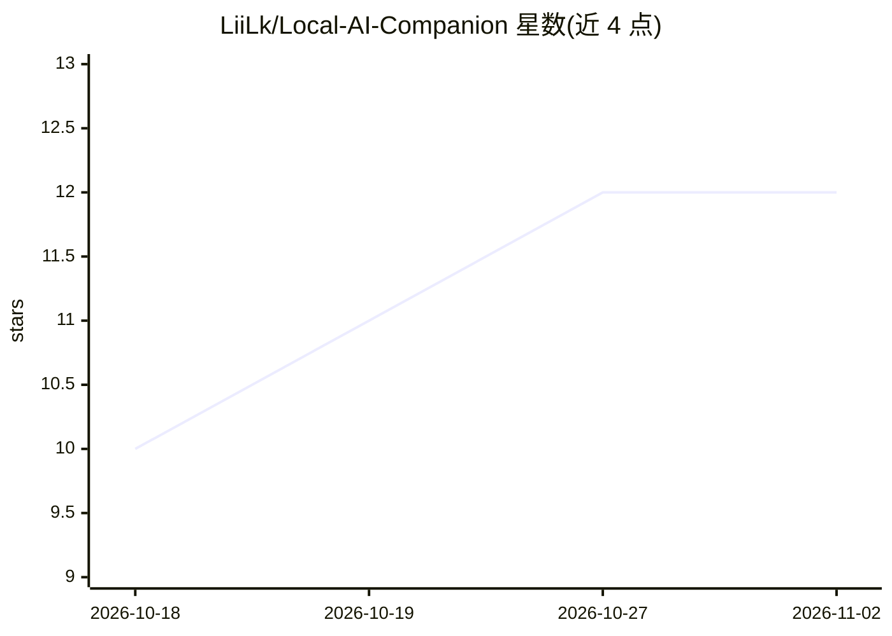

# LiiLk/Local-AI-Companion

⭐ 12 · Python · MIT · 推送 2026-10-01 · [GitHub](https://github.com/LiiLk/Local-AI-Companion) · 个人维护

**Windows 优先的离线本地 AI 桌面陪伴助手（Live2D + 语音对话）**

离线优先的桌面 AI 陪伴应用：默认语音管线为麦克风 → Silero VAD → Faster-Whisper ASR → LLM → Kokoro TTS → RVC 变声 → 播放，LLM 默认走本地 Ollama，可选用 OpenRouter 云端。提供 Live2D 桌面壳、浏览器 UI（FastAPI + WebSocket）、CLI 等入口，支持 YAML 角色预设与本地配置覆盖。Windows 11 为主要平台，WSL2 作为混合后端环境；推荐 NVIDIA GPU，可选 Qwen3/Gemma/MiniCPM-o 等实验路径需独立虚拟环境安装。

## 筛选速览

| 维度 | 判定 | 备注 |
|---|---|---|
| AI 角色 | `ai-native` | 本体是模型或模型工具 |
| 许可风险 | `permissive` | MIT |
| 部署形态 | `library` | 以包/库形式分发 |
| 模型依赖 | local-ok | 支持本地模型 |
| 硬件要求 | — | 无带数字的原话,不猜 |
| 安装摩擦 | `medium` | 含编译或系统依赖之一 |
| 成熟度 | — | 结构信号不足 |

## 能力要点

- 本地语音管线：Faster-Whisper ASR + Kokoro TTS + RVC 变声，ASR/TTS 默认离线
- 默认本地 LLM（Ollama），OpenRouter 为可选云端提供商
- Live2D 桌面壳 + 浏览器 UI + CLI 多入口，YAML 角色预设与配置覆盖
- config 驱动架构，管线/TTS 路由/RVC/WebSocket 等有测试覆盖

## 适用场景

- 在本地跑一个带 Live2D 形象的语音对话 AI 陪伴助手
- 不想依赖云端 API、希望 ASR/TTS/LLM 全离线运行
- 通过角色预设自定义助手人格与音色（如默认 march7th 预设）

## 场景标签

`语音 Agent` · 领域:对话与助手

## 证据(README 行号)

> L5:  Offline-first desktop AI companion with Live2D, realtime voice conversation, and a pragmatic local voice pipeline.
> L21: Microphone -> Silero VAD -> Faster-Whisper -> LLM text -> Kokoro TTS -> RVC -> Audio playback
> L26: - An **offline-first** assistant: ASR and TTS are local by default.

## 星数曲线

2026-10-18 10 → 2026-11-02 12（+2）

---
*卡片 v1 · prompt 1.4 · 生成 2026-11-01 · 置信度 mid · 依据 README sha `0f228e43a14a` · [字段定义](../../DATASET.md)*
