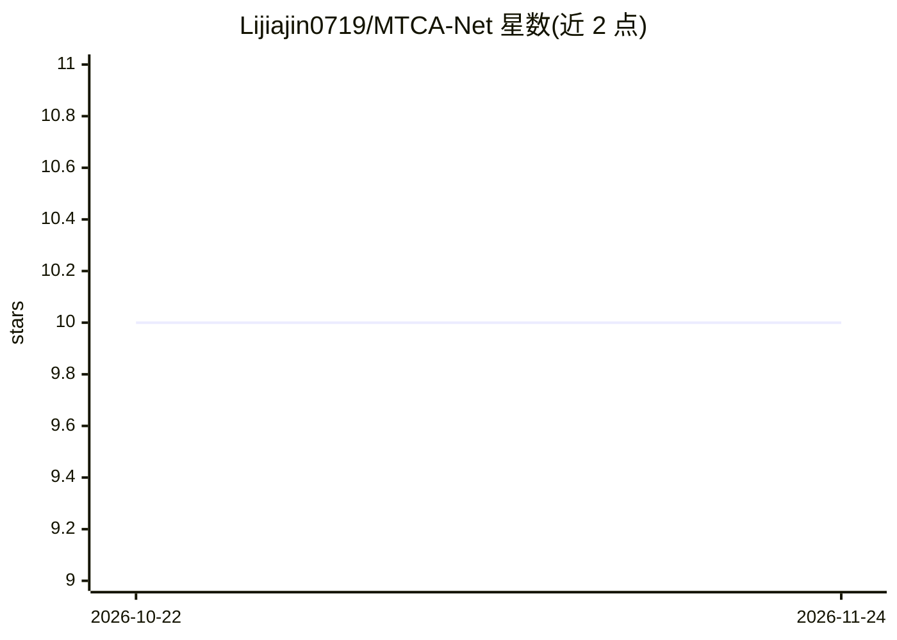

# Lijiajin0719/MTCA-Net

⭐ 10 · Python · AGPL-3.0 · 推送 2026-03-24 · [GitHub](https://github.com/Lijiajin0719/MTCA-Net) · 组织维护 · 中文 README

**面向科研人员的精子实时跟踪与分割级联网络实现**

论文 MTCA-Net 的官方代码实现，用于高分辨率条件下的精子实时跟踪与分割。采用多任务级联结构，包含检测模块（基于 AMF-YOLO）与分割模块（EffiFusion_U2Net）两部分，分别提供训练与测试脚本，并可对级联后的整体网络进行测试。代码基于 Ultralytics YOLO 项目参考构建，需要 Python 3.9 与 PyTorch 2.0.1 环境，配套提供 SHDet、SHSeg、SHSegHR 数据集的下载与放置说明。

## 筛选速览

| 维度 | 判定 | 备注 |
|---|---|---|
| AI 角色 | `ai-native` | 本体是模型或模型工具 |
| 许可风险 | `viral` | AGPL-3.0 |
| 部署形态 | `library` | 以包/库形式分发 |
| 模型依赖 | — | README 未给出锁定关系 |
| 硬件要求 | — | 无带数字的原话,不猜 |
| 安装摩擦 | `low` | 无编译、无系统依赖或容器化 |
| 成熟度 | — | 结构信号不足 |

## 能力要点

- 级联式检测与分割双模块，分别提供训练/测试脚本
- 提供整体级联网络的测试入口 test_MTCA.py 及置信度/分割阈值参数
- 配套 SHDet、SHSeg、SHSegHR 三个数据集
- 检测与分割中间结果分别保存到 runs/ 与 seg/run/ 目录

## 适用场景

- 复现论文中的精子实时跟踪与分割实验
- 在自己的精子显微图像数据上训练检测或分割模块
- 精子质量分析相关研究的方法对比

## 场景标签

`科研工具` `目标检测` · 领域:学习与行业

## 证据(README 行号)

> L3: A multi-task cascaded analysis network (MTCA-Net) for real-time tracking and segmentating sperm under high-resolutio
> L12: This project requires Python 3.9 and PyTorch 2.0.1. Follow these steps to set up the environment:

## 星数曲线

2026-10-22 10 → 2026-11-24 10（+0）

---
*卡片 v1 · prompt 1.4 · 生成 2026-11-20 · 置信度 high · 依据 README sha `26bc8fc5d46e` · [字段定义](../../DATASET.md)*
