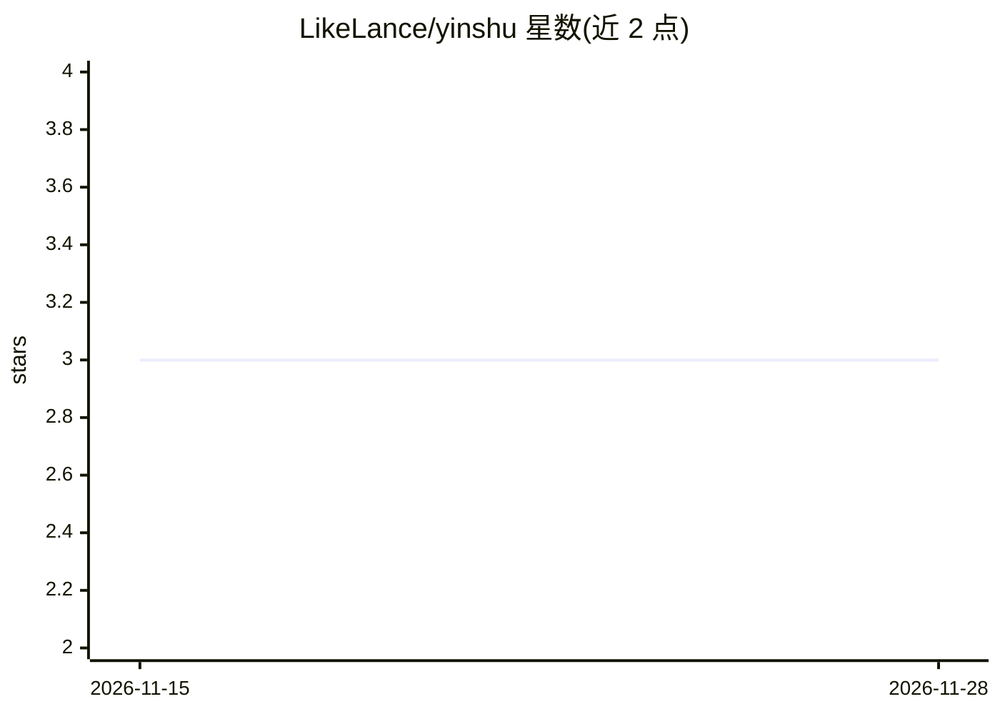

# LikeLance/yinshu

⭐ 3 · Python · NOASSERTION · 推送 2026-10-29 · [GitHub](https://github.com/LikeLance/yinshu) · 组织维护 · 中文 README

**面向银行业务场景的安全智能体演示系统**

以自然语言发起转账、账单查询、理财、卡片与订阅管理的银行智能体演示系统。默认使用规则 NLU 与模板化执行计划，不依赖外部大模型；重点在服务端权限边界、注入检测、工具网关（白名单/幂等/超时）、确认流程、审计哈希链与 SQLite 持久化。前后端一体启动，含 Mock 银行核心，不连接真实资金链路；仓库为 2026 FinTechathon 参赛项目，MIT 许可。

## 筛选速览

| 维度 | 判定 | 备注 |
|---|---|---|
| AI 角色 | `ai-native` | 本体是模型或模型工具 |
| 许可风险 | `none` | NOASSERTION |
| 部署形态 | `self-host` | docker 或自建部署 |
| 模型依赖 | — | README 未给出锁定关系 |
| 硬件要求 | — | 无带数字的原话,不猜 |
| 安装摩擦 | `low` | 无编译、无系统依赖或容器化 |
| 成熟度 | — | 结构信号不足 |

## 能力要点

- 策略引擎输出 AUTO/CONFIRM/HANDOFF/DENY 四级动作，不可逆操作需二次确认
- 注入检测拦截'忽略之前所有指令'类提示注入
- 工具调用统一经网关执行：白名单、幂等键、参数校验
- 带哈希链审计记录，支持增量与全量校验及外部锚定服务

## 适用场景

- 演示银行场景下自然语言办理转账与查询
- 研究智能体在资金操作中的权限与确认机制
- 参考提示注入检测与审计链的服务端实现

## 场景标签

`聊天机器人` `Agent 框架` · 领域:Agent 开发

## 证据(README 行号)

> L3: 银枢是一个面向银行业务场景的智能体演示系统。用户可以用自然语言发起转账、账单查询、理财、卡片管理、订阅处理和跨场景任务；后端负责意图解析、计划生成、风险判定、受控执行和审计记录。
> L5: 系统默认使用规则 NLU 与模板化执行计划，不依赖外部大模型。项目重点是服务端权限边界、确认流程、幂等控制和审计能力，而不是开放域对话。

## 星数曲线

2026-11-15 3 → 2026-11-28 3（+0）

---
*卡片 v1 · prompt 1.4 · 生成 2026-11-22 · 置信度 mid · 依据 README sha `e4ea60e49a3f` · [字段定义](../../DATASET.md)*
