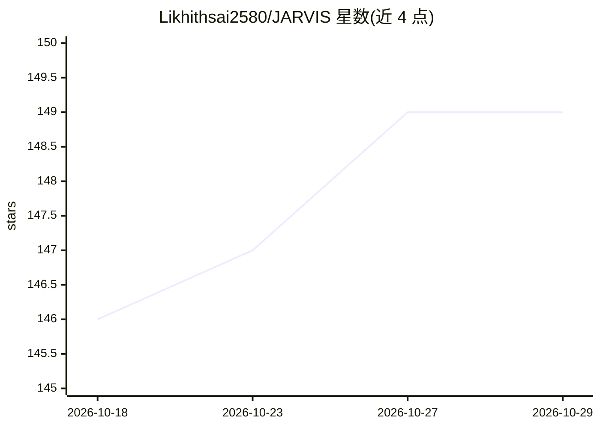

# Likhithsai2580/JARVIS

⭐ 149 · Python · MIT · 推送 2026-07-30 · [GitHub](https://github.com/Likhithsai2580/JARVIS) · 个人维护

**多功能离线 AI 助手：语音、OCR、图像生成与任务自动化**

以 Python 编写的桌面 AI 助手应用，功能包括语音识别与自然语言命令、网页抓取、OCR 文字提取、图像生成、PPT 自动生成、基于摄像头的目标检测、代码生成与任务自动化，通过 GUI 或语音交互。主题标签含 g4f 与 local-llm，说明涉及本地 LLM 与免费 API 通道（GEMINI_API、cookie_bing 等在 config.json 配置）。README 第一行声明项目已过时，更新版本迁移至其他仓库。安装方式为 git clone 源码加 pip 安装依赖，运行 main.py 启动。

## 筛选速览

| 维度 | 判定 | 备注 |
|---|---|---|
| AI 角色 | `ai-native` | 本体是模型或模型工具 |
| 许可风险 | `permissive` | MIT |
| 部署形态 | `library` | 以包/库形式分发 |
| 模型依赖 | — | README 未给出锁定关系 |
| 硬件要求 | — | 无带数字的原话,不猜 |
| 安装摩擦 | `low` | 无编译、无系统依赖或容器化 |
| 成熟度 | — | 结构信号不足 |

## 能力要点

- 语音识别与自然语言命令交互
- OCR、图像生成、PPT 生成、目标检测等多功能集成
- 支持本地 LLM（主题标签 local-llm/g4f）与免费 API 配置
- 提供 GUI 界面与语音两种交互方式

## 适用场景

- 用语音命令执行日常任务自动化
- 从图片或扫描文档提取文字
- 生成图像、演示文稿与代码片段

## 场景标签

`AI 助手` `语音识别` `OCR` `图像生成` · 领域:对话与助手

## 证据(README 行号)

> L11: Jarvis is more than just another virtual assistant; it's a comprehensive solution packed with powerful features. Co
> L40: - **Voice Recognition and Processing**: Communicate using natural language commands.
> L43: - **Image Generation**: Create visual content dynamically.

## 星数曲线

2026-10-18 146 → 2026-10-29 149（+3）

---
*卡片 v1 · prompt 1.4 · 生成 2026-10-22 · 置信度 high · 依据 README sha `9f1bf063a43d` · [字段定义](../../DATASET.md)*
