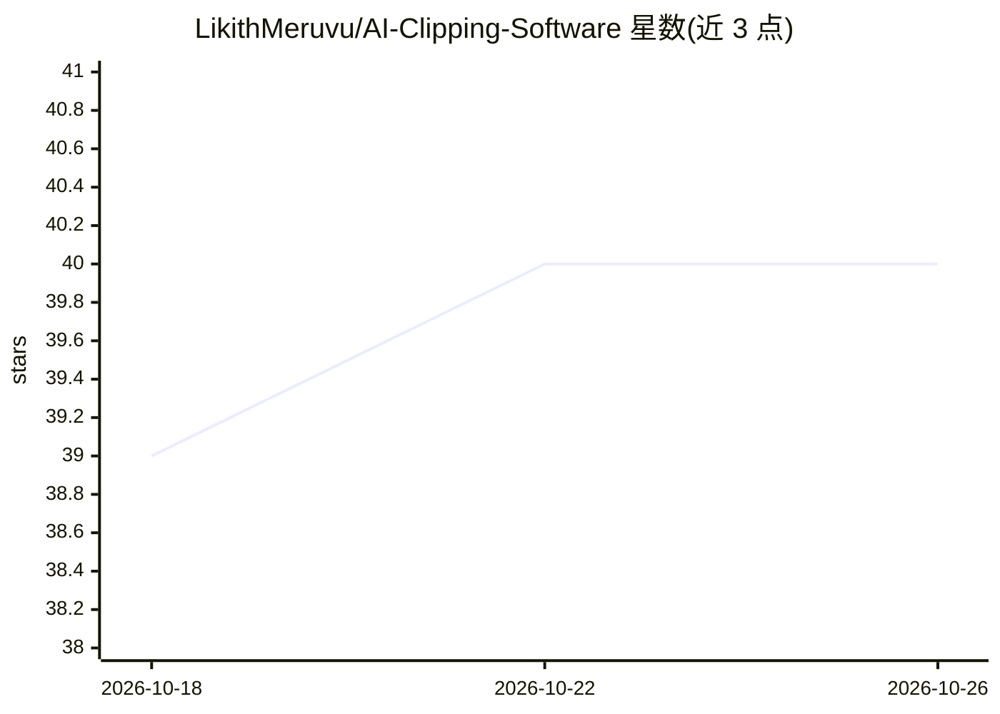

# LikithMeruvu/AI-Clipping-Software

⭐ 40 · Python · MIT · 推送 2026-01-02 · [GitHub](https://github.com/LikithMeruvu/AI-Clipping-Software) · [官网](https://dqzlwjzg.manus.space) · 个人维护

**AI 自动剪辑工具：从 YouTube 视频生成短视频片段**

开源的 Python 命令行工具，读取用户提供的 YouTube URL，调用 Gemini API 自动识别视频中具吸引力的片段，生成带智能人脸跟踪构图与逐词字幕的短视频，输出保存到 clips 目录。配置通过 .env 文件填入 GEMINI_API_KEY 完成。安装方式为 git clone 源码并 pip 安装依赖，运行 main.py 交互式使用。README 提示 YouTube 下载可能失败，需更新 pytube 或设置自定义 user agent。

## 筛选速览

| 维度 | 判定 | 备注 |
|---|---|---|
| AI 角色 | `ai-native` | 本体是模型或模型工具 |
| 许可风险 | `permissive` | MIT |
| 部署形态 | `library` | 以包/库形式分发 |
| 模型依赖 | — | README 未给出锁定关系 |
| 硬件要求 | — | 无带数字的原话,不猜 |
| 安装摩擦 | `low` | 无编译、无系统依赖或容器化 |
| 成熟度 | — | 结构信号不足 |

## 能力要点

- AI 自动识别视频中值得剪辑的片段
- 智能人脸跟踪保持说话者构图
- 生成逐词字幕（多种样式）
- 通过 .env 配置 Gemini API key 与下载参数

## 适用场景

- 把长视频自动切成适合短视频平台的片段
- 为播客或访谈视频生成带字幕的短内容
- 批量尝试从既有视频中挑选高光片段

## 场景标签

`图像视频处理` · 领域:感知与多模态

## 证据(README 行号)

> L7: - **AI-Powered Clip Selection**: Automatically identifies the most engaging and viral-worthy moments in a video.
> L26:  Copy the `.env.example` file to `.env` and add your Gemini API key.

## 星数曲线

2026-10-18 39 → 2026-10-26 40（+1）

---
*卡片 v1 · prompt 1.4 · 生成 2026-10-25 · 置信度 high · 依据 README sha `9877991a9aa5` · [字段定义](../../DATASET.md)*
