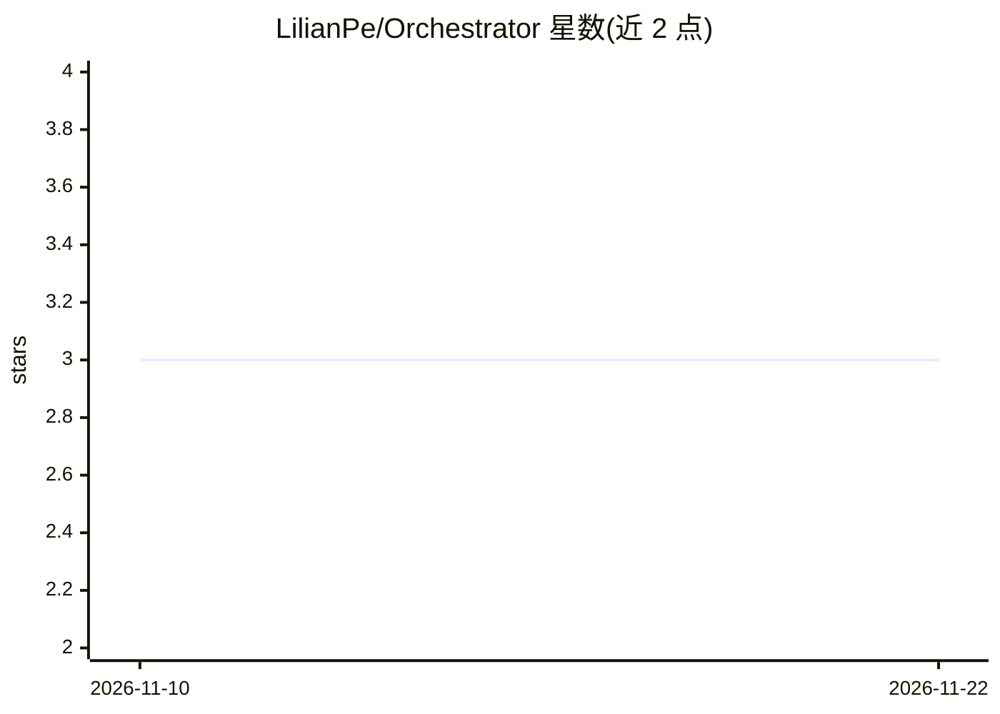

# LilianPe/Orchestrator

⭐ 3 · TypeScript · NOASSERTION · 推送 2026-11-21 · [GitHub](https://github.com/LilianPe/Orchestrator) · 个人维护

**把 Linear 工单委派给 coding agent，产出经 AI 与人工双重复审的 PR**

以 daemon（`factory up`）形式运行的 coding agent 编排器：将 Linear 中委派的工单转为独立 git worktree 中的 headless Claude Code 会话，生成 PR 后经 AI review 循环再交人工复审，合并权仅归人类。行为由 `factory/default` 预设编译在代码中，仓库通过 `.factory/config.yml` 追加命令、检查与限额；agent 指令放在 skills pack 中。前置要求包括 Node.js、Claude CLI 登录、GitHub App、Linear 工作区及 Podman（文档提及）。原型阶段，Elastic License 2.0 许可。

## 筛选速览

| 维度 | 判定 | 备注 |
|---|---|---|
| AI 角色 | `ai-ecosystem` | LLM/agent 周边工具 |
| 许可风险 | `none` | NOASSERTION |
| 部署形态 | `None` |  |
| 模型依赖 | — | README 未给出锁定关系 |
| 硬件要求 | — | 无带数字的原话,不猜 |
| 安装摩擦 | `low` | 无编译、无系统依赖或容器化 |
| 成熟度 | `idea` | |

## 能力要点

- Linear 工单委派→PR→AI review→人工复审的完整流水线
- 每个工单独立 git worktree，会话跨运行恢复（反馈、CI、review）
- 预设 + `.factory/config.yml` 仓库级配置叠加，基线不可移除
- 威胁模型文档与外部效果的幂等性测试表

## 适用场景

- 团队用 Linear 管理需求，想让 agent 承接工单产出 PR
- 要求 AI 生成代码必须经人工决定合并的流程
- 以 CLI 管理 agent 工厂的启动、暂停、dry-run 与重放

## 场景标签

`编码 Agent` · 领域:编码与开发

## 证据(README 行号)

> L3: Coding agent orchestrator: a Linear ticket delegated to the agent becomes a PR, reviewed by an AI review loop and th
> L6: - Each delegated ticket gets its own git worktree and a headless **Claude Code** session, resumed from run to run (f
> L7: - Behavior (events, jobs, models, limits, checks) is the `factory/default` preset, compiled in the code; a repositor

## 星数曲线

2026-11-10 3 → 2026-11-22 3（+0）

---
*卡片 v1 · prompt 1.4 · 生成 2026-11-22 · 置信度 high · 依据 README sha `489bed45944c` · [字段定义](../../DATASET.md)*
