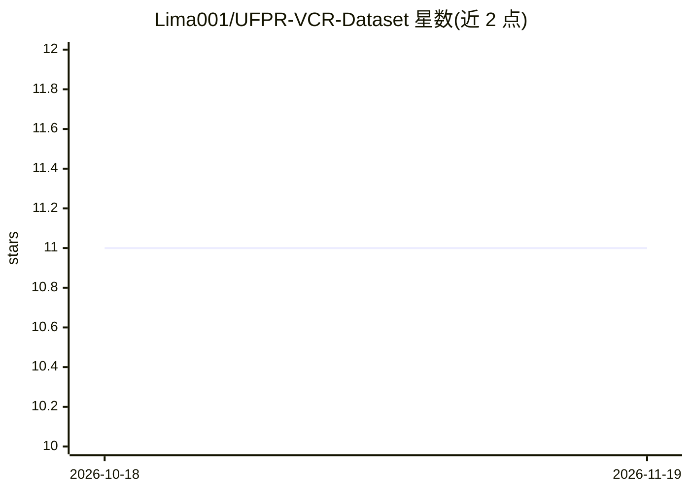

# Lima001/UFPR-VCR-Dataset

⭐ 11 · 推送 2026-09-07 · [GitHub](https://github.com/Lima001/UFPR-VCR-Dataset) · [官网](https://doi.org/10.1109/SIBGRAPI62404.2024.10716307) · 组织维护

**面向科研者的复杂场景车辆颜色识别数据集（10,039 图）**

UFPR-VCR 是一个车辆颜色识别数据集，包含 10,039 张图像、9,502 辆不同车辆，覆盖正面/尾部视角、部分遮挡、多样光照与夜间等真实条件。图像源自巴西六个公开 ALPR 数据集并经预处理与筛选，标注 11 种车辆颜色，超过 90% 的标注通过原车牌标注信息验证。数据集仅限学术研究、非商业用途，需签署许可协议并用大学邮箱向作者申请下载链接。构建过程与深度学习基准实验见配套论文。

## 筛选速览

| 维度 | 判定 | 备注 |
|---|---|---|
| AI 角色 | `ai-knowledge` | 知识聚合/清单类 |
| 许可风险 | `none` | — |
| 部署形态 | `None` |  |
| 模型依赖 | — | README 未给出锁定关系 |
| 硬件要求 | — | 无带数字的原话,不猜 |
| 安装摩擦 | `low` | 无编译、无系统依赖或容器化 |
| 成熟度 | — | 结构信号不足 |

## 能力要点

- 10,039 张图像、9,502 辆车辆，覆盖遮挡/夜间/多样光照等复杂条件
- 11 种颜色标注，90% 以上经车牌信息验证
- 源自六个巴西公开 ALPR 数据集的预处理筛选结果
- 附 SIBGRAPI 2024 论文与基准实验

## 适用场景

- 训练和评测复杂场景下的车辆颜色识别模型
- 研究恶劣条件（遮挡、夜间）对识别性能的影响
- 智能交通系统相关的学术研究

## 场景标签

`模型评测` `科研工具` `目标检测` · 领域:评测与运维

## 证据(README 行号)

> L3: The UFPR Vehicle Color Recognition (UFPR-VCR) dataset was created to tackle vehicle color recognition in more comple
> L7: The UFPR-VCR dataset contains 10,039 images of 9,502 distinct vehicles across various categories, including cars, va
> L31: As we are not the creators of the original ALPR datasets, we have decided to grant access to the images we have gen

## 星数曲线

2026-10-18 11 → 2026-11-19 11（+0）

---
*卡片 v1 · prompt 1.4 · 生成 2026-11-19 · 置信度 high · 依据 README sha `f9e7b07ef347` · [字段定义](../../DATASET.md)*
