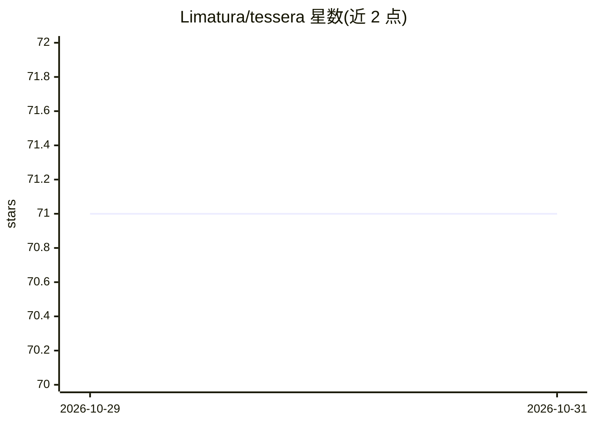

# Limatura/tessera

⭐ 71 · Rust · AGPL-3.0 · 推送 2026-10-29 · [GitHub](https://github.com/Limatura/tessera) · [官网](https://tessera-docs-three.vercel.app) · 个人维护 · 中文 README

**自托管临时文件/文本分享服务，到期或达下载上限后自动删除**

单二进制自托管的文件、文件夹、代码片段与链接分享服务：上传后返回短码与 URL，接收方在到期或达到下载数上限前可访问，随后自动删除。支持匿名或账户模式（GitHub/Discord/OpenID Connect），数据存于 SQLite/PostgreSQL/MySQL，文件可放本地磁盘、S3 兼容存储、Azure Blob、GCS 或 WebDAV。提供 Docker 部署、Web 管理面板、OpenAPI 接口与 `tess` 命令行客户端（含客户端加密 `--encrypt`）。限制：公开实例需自行配置存储上限与恶意软件扫描。README 未展示 AI/MCP 相关功能细节。

## 筛选速览

| 维度 | 判定 | 备注 |
|---|---|---|
| AI 角色 | `ai-enhanced` | 去掉 AI 部分产品仍成立 |
| 许可风险 | `viral` | AGPL-3.0 |
| 部署形态 | `desktop` | 安装包/桌面程序 |
| 模型依赖 | — | README 未给出锁定关系 |
| 硬件要求 | — | 无带数字的原话,不猜 |
| 安装摩擦 | `low` | 无编译、无系统依赖或容器化 |
| 成熟度 | — | 结构信号不足 |

## 能力要点

- 到期时间与下载数上限控制的自动删除分享
- 单二进制运行，内置 Web 应用，支持 SQLite/PostgreSQL/MySQL 三种数据库
- 可混用多种存储后端（本地/S3/Azure Blob/GCS/WebDAV），大文件可直传对象存储绕过服务器
- `tess` CLI 支持端到端加密（密钥保留在链接 # 后，服务器不可见）

## 适用场景

- 在 NAS 或家庭服务器上搭建私人文件中转服务，设备间或与好友传文件
- 为团队或组织提供带 OIDC 登录、角色与配额的内部文件共享
- 通过短码限时分享代码片段或一次性大文件

## 场景标签

 · 领域:文件共享/自托管服务

## 证据(README 行号)

> L3:  Self-hosted file and note sharing that cleans up after itself.
> L14: Upload a file, a folder, a snippet of code or a link, and get back a short code and a URL. Whoever has them can ope

## 星数曲线

2026-10-29 71 → 2026-10-31 71（+0）

---
*卡片 v1 · prompt 1.4 · 生成 2026-10-28 · 置信度 low · 依据 README sha `2007b0a4ccba` · [字段定义](../../DATASET.md)*
