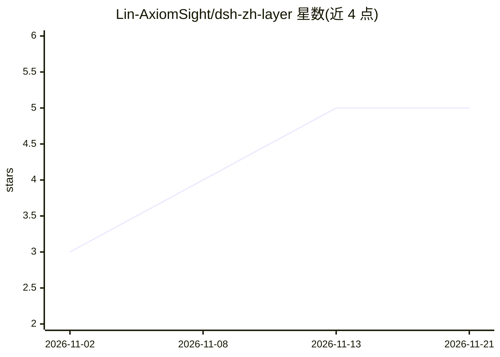

# Lin-AxiomSight/dsh-zh-layer

⭐ 5 · JavaScript · MIT · 推送 2026-11-11 · [GitHub](https://github.com/Lin-AxiomSight/dsh-zh-layer) · 个人维护 · 中文 README

**为 DSH 客户端提供中英双语界面覆盖层的插件**

运行于 DSH（DeepSeek Harness）的插件，不改 DSH 源码，通过运行时包装元数据与前端排版，把命令、技能、插件列表渲染为「中文名 + 英文原名 + 中文描述」。提供 zh/both/off 三种显示模式一键切换，AI 翻译由用户手动触发，仅提交未翻译条目并使用翻译缓存，基于原生 Node.js 与浏览器 API，无第三方 npm 依赖，支持 Windows/macOS/Linux。翻译默认调用 DeepSeek 官方 deepseek-flash 模型，暂不支持自定义；排版依赖 DSH 现有 DOM 结构。

## 筛选速览

| 维度 | 判定 | 备注 |
|---|---|---|
| AI 角色 | `ai-enhanced` | 去掉 AI 部分产品仍成立 |
| 许可风险 | `permissive` | MIT |
| 部署形态 | `None` |  |
| 模型依赖 | locked-api |  |
| 硬件要求 | — | 无带数字的原话,不猜 |
| 安装摩擦 | `low` | 无编译、无系统依赖或容器化 |
| 成熟度 | — | 结构信号不足 |

## 能力要点

- 三种显示模式（zh/both/off）一键切换，英文原名可保留作索引
- AI 翻译手动触发，增量翻译配合缓存，不点按钮零 Token 消耗
- 零第三方 npm 依赖，非侵入式包装，卸载即恢复原版
- 提供命令行、客户端图形界面、插件市场三种安装途径

## 适用场景

- 安装了大量英文插件后希望以中文快速辨认功能
- 录屏或演示时一键关闭翻译恢复英文原版界面
- 手动编辑词典微调插件与命令的译文

## 场景标签

 · 领域:开发工具/本地化插件

## 证据(README 行号)

> L10: **这是一层可开关的 DeepSeek Harness 双语覆盖层。**
> L12: 它不改 DSH 一行源码，通过运行时包装元数据和前端排版，把命令、技能和插件列表渲染成「中文名称 + 英文原名 + 中文功能描述」的形态。
> L22: - **AI 翻译纯手动触发，绝不偷偷扣费**：由你决定何时点击翻译。仅提交未翻译条目，不点按钮零 Token 消耗。

## 星数曲线

2026-11-02 3 → 2026-11-21 5（+2）

---
*卡片 v1 · prompt 1.4 · 生成 2026-11-21 · 置信度 high · 依据 README sha `7e50a44f36f3` · [字段定义](../../DATASET.md)*
