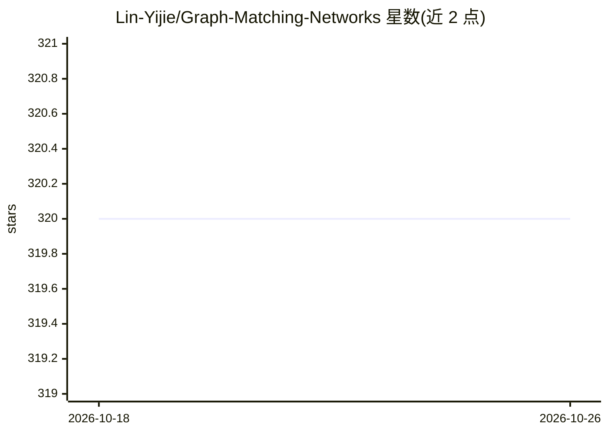

# Lin-Yijie/Graph-Matching-Networks

⭐ 320 · Python · NOASSERTION · 推送 2026-06-16 · [GitHub](https://github.com/Lin-Yijie/Graph-Matching-Networks) · 个人维护

**图匹配网络的 PyTorch 实现集合（COMMON/GMN 等论文代码）**

提供多个图匹配算法的 PyTorch 实现，包括 COMMON（ICCV 2023，双层噪声对应下的图匹配）与 GMN（ICML 2019，学习图结构对象相似度的图匹配网络），README 中逐条列出对应论文与代码目录链接。面向图学习与计算机视觉方向的科研人员，用于复现论文方法或开展图匹配研究。仓库内容以论文实现为主，未提供安装说明与使用文档。

## 筛选速览

| 维度 | 判定 | 备注 |
|---|---|---|
| AI 角色 | `ai-native` | 本体是模型或模型工具 |
| 许可风险 | `none` | NOASSERTION |
| 部署形态 | `None` |  |
| 模型依赖 | — | README 未给出锁定关系 |
| 硬件要求 | — | 无带数字的原话,不猜 |
| 安装摩擦 | `low` | 无编译、无系统依赖或容器化 |
| 成熟度 | — | 结构信号不足 |

## 能力要点

- COMMON（ICCV 2023）双层噪声对应图匹配的 PyTorch 实现
- GMN（ICML 2019）图结构相似度学习的实现
- 逐条对应论文 PDF 与代码目录链接

## 适用场景

- 复现 COMMON/GMN 论文的图匹配方法
- 作为图匹配研究的代码基础进行改进
- 学习图匹配网络的 PyTorch 实现方式

## 场景标签

`科研工具` · 领域:学习与行业

## 证据(README 行号)

> L5: In this repo, a number of implementations of Graph Matching algorithms are provided.
> L7: > Yijie Lin, Mouxing Yang, Jun Yu, Peng Hu, Changqing Zhang, Xi Peng. *Graph Matching with Bi-level Noisy Correspond
> L9: > Yujia Li, Chenjie Gu, Thomas Dullien, Oriol Vinyals, Pushmeet Kohli. *Graph Matching Networks for Learning the Sim

## 星数曲线

2026-10-18 320 → 2026-10-26 320（+0）

---
*卡片 v1 · prompt 1.4 · 生成 2026-10-21 · 置信度 mid · 依据 README sha `4a56dbb36e7e` · [字段定义](../../DATASET.md)*
