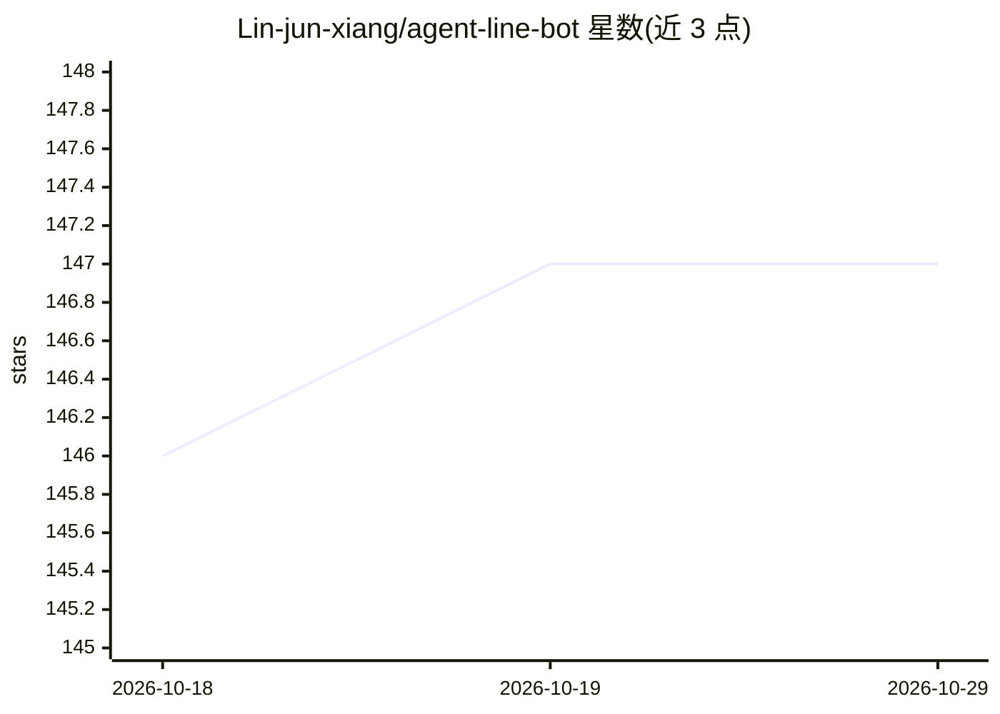

# Lin-jun-xiang/agent-line-bot

⭐ 147 · Python · MIT · 推送 2026-08-26 · [GitHub](https://github.com/Lin-jun-xiang/agent-line-bot) · 个人维护 · 中文 README

**住在 LINE 裡的免費 AI 助理機器人，可查網、產圖產片、跑程式**

以 Claude Code CLI 作為 agent harness、接上免費 GLM 模型（GLM-4.7-Flash/CogView/CogVideoX/GLM-4V）的 LINE 聊天機器人。終端使用者透過一對一或群組 @ 對話，獲得程式執行、網路搜尋、圖片生成與推理、影片生成等模型輸出，並支援每位使用者的偏好記憶。agent 被鎖在 workspace/ 沙箱（四層防線、48 個測試），檔案讀寫與 shell 只在工作目錄活動。模型、搜尋、部署均有免費方案，可用 Docker、Render 或 ngrok 部署。

## 筛选速览

| 维度 | 判定 | 备注 |
|---|---|---|
| AI 角色 | `ai-native` | 本体是模型或模型工具 |
| 许可风险 | `permissive` | MIT |
| 部署形态 | `library` | 以包/库形式分发 |
| 模型依赖 | locked-api |  |
| 硬件要求 | — | 无带数字的原话,不猜 |
| 安装摩擦 | `low` | 无编译、无系统依赖或容器化 |
| 成熟度 | — | 结构信号不足 |

## 能力要点

- 把 Claude Code CLI 封裝為 agent harness，接免費 GLM 模型
- workspace/ 沙箱四層防線限制檔案與 shell 權限
- 支援網路搜尋、圖片生成/推理、影片生成、程式執行
- 每位使用者獨立記憶與偏好，支援定時推播與技能系統

## 适用场景

- 在 LINE 裡直接問即時新聞、天氣、股價
- 讓機器人跑 Python 驗證計算或整理資料產報表
- 傳圖提問或用文字/圖片生成圖片與影片
- 自建免費方案部署的個人 AI 助理

## 场景标签

`聊天机器人` `AI 助手` `多模态` · 领域:对话与助手

## 证据(README 行号)

> L5: 底層不是手刻的 function-calling 迴圈，而是把 **Claude Code CLI 當成 agent harness 封裝起來，
> L86:                               ├──► agent_core/runner.py ──► claude CLI ──► GLM
> L110: |模型|GLM-4.7-Flash（免費）· CogView · CogVideoX · GLM-4V|

## 星数曲线

2026-10-18 146 → 2026-10-29 147（+1）

---
*卡片 v1 · prompt 1.4 · 生成 2026-10-23 · 置信度 mid · 依据 README sha `fe28d3f48484` · [字段定义](../../DATASET.md)*
