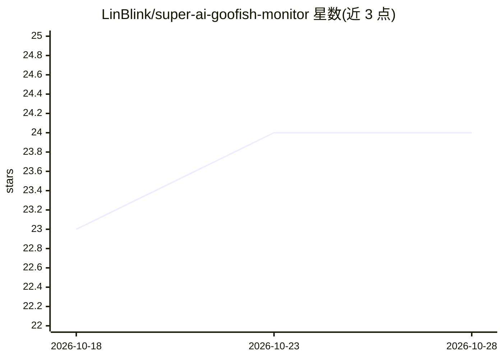

# LinBlink/super-ai-goofish-monitor

⭐ 25 · Python · MIT · 推送 2026-09-19 · [GitHub](https://github.com/LinBlink/super-ai-goofish-monitor) · 个人维护 · 中文 README

**闲鱼商品监控与捡漏工具：爬取筛选加 AI 分析推送**

基于 Playwright + FastAPI + Vue + SQLite 的闲鱼商品监控系统：多任务并发爬取商品，支持关键词/价格区间/地区筛选与正则黑名单两级拦截；AI 部分用多模态模型（OpenAI 兼容接口）按自然语言需求对商品图文与卖家信息做判断，支持多模型兜底、429/故障自动切换与超时熔断，并有 AI 标题预筛。另提供价格趋势分析、抄底机会识别、账号与代理轮换、六渠道通知。Docker 镜像内置 Chromium，或本地 Python 3.10+ / Node.js 源码运行。仅供学习与个人使用。

## 筛选速览

| 维度 | 判定 | 备注 |
|---|---|---|
| AI 角色 | `ai-enhanced` | 去掉 AI 部分产品仍成立 |
| 许可风险 | `permissive` | MIT |
| 部署形态 | `self-host` | docker 或自建部署 |
| 模型依赖 | — | README 未给出锁定关系 |
| 硬件要求 | — | 无带数字的原话,不猜 |
| 安装摩擦 | `low` | 无编译、无系统依赖或容器化 |
| 成熟度 | — | 结构信号不足 |

## 能力要点

- 多任务并发爬取，关键词/价格/地区筛选与两级黑名单爬取阶段拦截
- 多模态 AI 判断商品图文与卖家信息，多模型兜底 + 超时熔断
- 价格趋势曲线与「持续下跌可抄底」识别（末 3 次递减且跌幅 ≥10%）
- Web 端全功能管理，Docker 一键部署（内置 Chromium）

## 适用场景

- 监控闲鱼上心仪价位的商品并及时收到通知
- 跟踪商品价格走势，寻找持续下跌的抄底机会
- 用自然语言描述需求让 AI 自动筛选商品

## 场景标签

`网页抓取` · 领域:效率与自动化

## 证据(README 行号)

> L11: > 基于 Playwright + 多模态 AI 的闲鱼商品监控与智能筛选系统，多任务并发，Web 端全功能管理。
> L22: - **多模态 AI 判断**：用自然语言描述购买需求即可生成分析标准，AI 结合商品图文、卖家信息综合判断
> L29: - **结果智能排序与时间筛选**：AI 推荐商品优先展示，其余按价格升序；时间范围支持全部 / 一天内 / 三天内 / 七天内快速切换

## 星数曲线

2026-10-18 23 → 2026-10-28 24（+1）

---
*卡片 v1 · prompt 1.4 · 生成 2026-10-27 · 置信度 mid · 依据 README sha `04ef729db543` · [字段定义](../../DATASET.md)*
