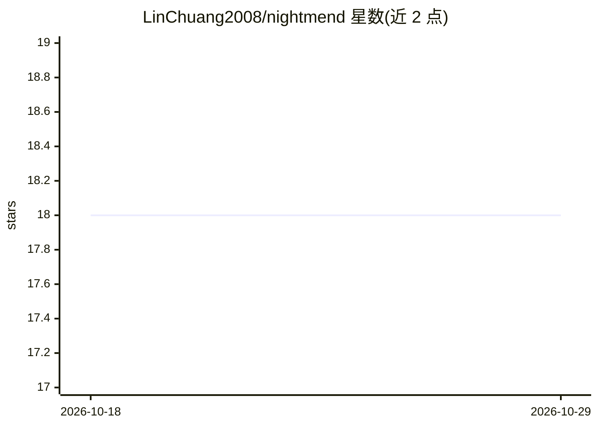

# LinChuang2008/nightmend

⭐ 18 · Python · Apache-2.0 · 推送 2026-07-05 · [GitHub](https://github.com/LinChuang2008/nightmend) · [官网](https://demo.lchuangnet.com) · 个人维护 · 中文 README

**带 AI 诊断与自动修复的开源自托管监控平台**

自托管的基础设施监控平台：Agent 采集 Linux/Windows/macOS 主机指标、服务发现与日志，后端（FastAPI + PostgreSQL/Redis，Docker Compose 部署）接收 Prometheus AlertManager 告警后调用 DeepSeek 做根因分析，并从 13 个内置 Runbook 中选择执行自动修复，支持审批流程与只读诊断两种模式。提供 MCP 集成（5 个工具）供 Claude Code/Cursor 查询生产数据，支持 PromQL 查询与 Grafana 集成。README 自述早期阶段，不建议用于大规模关键系统。

## 筛选速览

| 维度 | 判定 | 备注 |
|---|---|---|
| AI 角色 | `ai-native` | 本体是模型或模型工具 |
| 许可风险 | `permissive` | Apache-2.0 |
| 部署形态 | `self-host` | docker 或自建部署 |
| 模型依赖 | locked-api |  |
| 硬件要求 | — | 无带数字的原话,不猜 |
| 安装摩擦 | `low` | 无编译、无系统依赖或容器化 |
| 成熟度 | `idea` | |

## 能力要点

- DeepSeek 根因分析 + 13 个内置自动修复 Runbook
- MCP 集成，供 AI 编码助手查询实时生产数据（5 个工具）
- Prometheus AlertManager 桥接，3 行配置接入告警
- 自然语言描述场景生成可执行 Runbook
- 跨平台 Agent（Linux/Windows/macOS）采集指标、日志与数据库监控

## 适用场景

- 接手已有 Prometheus 告警，让 AI 做根因分析
- 小团队用 Docker 自托管监控并自动修复磁盘/CPU 等常见故障
- 通过 Claude Code/Cursor 查询生产服务器健康与告警数据

## 场景标签

 · 领域:运维监控/AIOps

## 证据(README 行号)

> L27: 1. **AI Analyzes** — DeepSeek reads logs, metrics, topology to find the real cause
> L28: 2. **AI Decides** — Picks the right Runbook from 13 built-in auto-remediation scripts
> L93: Two modes: **Diagnosis-only** (safe, read-only analysis) or **Auto-remediation** (AI picks and executes the right R
> L105: Your AI assistant (Claude Code, Cursor) queries live production data via MCP:

## 星数曲线

2026-10-18 18 → 2026-10-29 18（+0）

---
*卡片 v1 · prompt 1.4 · 生成 2026-10-29 · 置信度 mid · 依据 README sha `92fa8801967a` · [字段定义](../../DATASET.md)*
