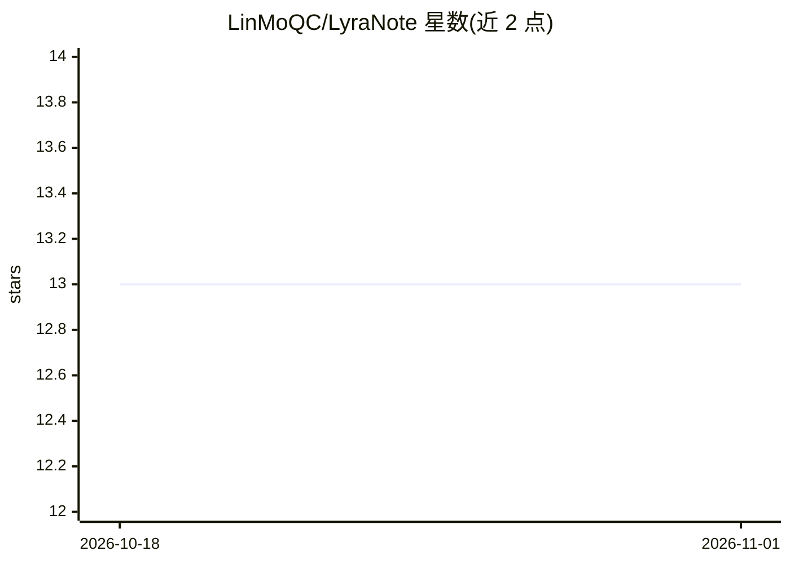

# LinMoQC/LyraNote

⭐ 13 · TypeScript · MIT · 推送 2026-05-01 · [GitHub](https://github.com/LinMoQC/LyraNote) · [官网](https://lyra-note-qi8sn2nti-karenskys-projects.vercel.app) · 个人维护 · 中文 README

**面向知识工作者的 AI 个人知识库与笔记应用**

以 RAG、多步 Agent、知识图谱与长期记忆为核心的个人知识管理应用：支持导入 PDF/URL/Markdown 自动分块向量化，AI 基于笔记本知识库回答并附来源引用；提供深度研究 Agent（联网浏览生成结构化报告）、编辑器旁挂 AI Copilot、行内 Ghost Text 补全、一键生成摘要/FAQ/学习指南、Cron 定时任务与邮件投递。前端 Next.js 15 + Tiptap，后端 FastAPI + PostgreSQL/pgvector + Celery + LangGraph，通过 OpenAI SDK 调用 LLM。提供本地开发、Docker Compose 与 Vercel + 自有服务器三种部署方式，要求 Node.js ≥ 18 与 Docker。

## 筛选速览

| 维度 | 判定 | 备注 |
|---|---|---|
| AI 角色 | `ai-native` | 本体是模型或模型工具 |
| 许可风险 | `permissive` | MIT |
| 部署形态 | `self-host` | docker 或自建部署 |
| 模型依赖 | — | README 未给出锁定关系 |
| 硬件要求 | — | 无带数字的原话,不猜 |
| 安装摩擦 | `low` | 无编译、无系统依赖或容器化 |
| 成熟度 | — | 结构信号不足 |

## 能力要点

- RAG 对话回答附来源引用，自动构建实体关系知识图谱
- 多步深度研究 Agent 联网浏览并生成结构化研究报告
- AI 配置（API key、模型）经 Setup Wizard 存数据库而非 .env
- lyra CLI 一键初始化并启动本地开发/全容器部署

## 适用场景

- 把 PDF、网页、Markdown 汇成可对话的个人知识库
- 写笔记时用侧边 AI 助手与行内补全辅助写作
- 定时生成新闻摘要/知识简报并发送到邮箱
- 自托管部署为团队的 AI 笔记服务

## 场景标签

`知识库管理` `知识图谱` `文档问答` · 领域:知识与检索

## 证据(README 行号)

> L25: **LyraNote** is a modern, AI-powered personal knowledge management app designed to be your *second brain*. By integ
> L32: - **RAG Conversations** — AI answers questions grounded in your notebook's knowledge base, with source citations.

## 星数曲线

2026-10-18 13 → 2026-11-01 13（+0）

---
*卡片 v1 · prompt 1.4 · 生成 2026-10-31 · 置信度 high · 依据 README sha `8583fbbd0147` · [字段定义](../../DATASET.md)*
