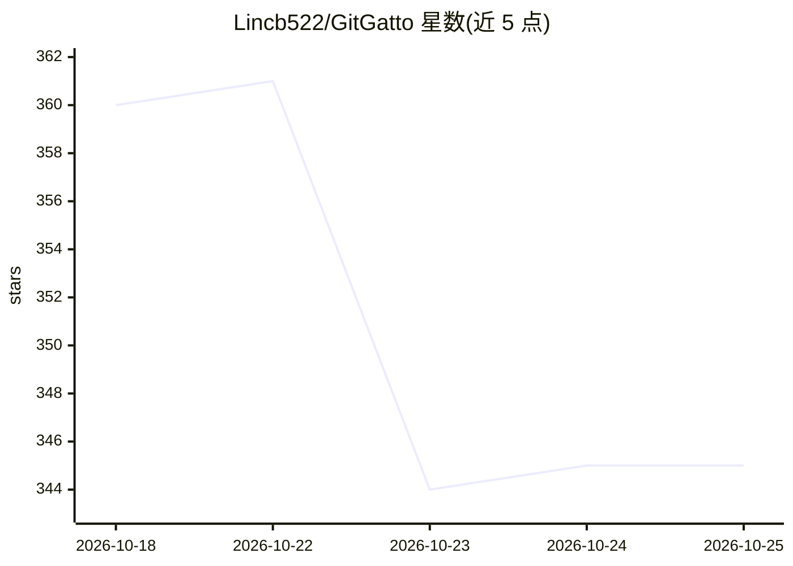

# Lincb522/GitGatto

⭐ 346 · Swift · MIT · 推送 2026-09-16 · [GitHub](https://github.com/Lincb522/GitGatto) · 个人维护 · 中文 README

**macOS 原生 Git/GitHub 客户端：Agent 参与仓库管理与交付保护**

Swift/SwiftUI 编写的 macOS 桌面应用，覆盖 Git 与 GitHub 日常操作（提交、PR、Issue、Actions、分支整理），并围绕外部 Agent 做工程化配套：未提交代码灾备与恢复点、仓库守卫观察外部 Agent 造成的删除与引用回退、Agent 活动记录与证据强度、目标交付按实际状态核验而非采信 Agent 文字回复。Agent 侧支持配置 Codex CLI、Claude Code、Gemini CLI 等 CLI，或 OpenAI 兼容/DeepSeek API。从 Releases 下载 DMG 安装，最低 macOS 14。

## 筛选速览

| 维度 | 判定 | 备注 |
|---|---|---|
| AI 角色 | `ai-enhanced` | 去掉 AI 部分产品仍成立 |
| 许可风险 | `permissive` | MIT |
| 部署形态 | `None` |  |
| 模型依赖 | locked-api |  |
| 硬件要求 | — | 无带数字的原话,不猜 |
| 安装摩擦 | `low` | 无编译、无系统依赖或容器化 |
| 成熟度 | — | 结构信号不足 |

## 能力要点

- 未提交代码灾备（Git bundle + 未提交文件，每仓库最多保留 3 份恢复点）
- 仓库守卫与外部 Agent 活动记录，关联文件/引用变化与 Agent 进程
- 目标交付逐项核验实际状态，不把 Agent 回复当成功结果
- 变更中心将混合改动拆分为多个提交，Agent 可整理分组
- 支持 8 类 Agent CLI 及 OpenAI 兼容/DeepSeek API，密钥存系统钥匙串

## 适用场景

- 在 macOS 上完成 Git 提交、PR 审阅与发布等日常仓库工作
- 让 Agent 改代码后，我需要留恢复点并核查它到底改了什么
- 把混在一起的改动拆成多个有清晰说明的提交
- 用 git bisect 在独立工作树里定位回归并交给 Agent 修复

## 场景标签

 · 领域:开发者工具/Git 客户端

## 证据(README 行号)

> L41: GitGatto 是 macOS 原生 Git 与 GitHub 客户端，支持 Apple Silicon 和 Intel。除了日常仓库操作，还提供未提交代码备份、外部 Agent 活动记录、目标交付、回归定位和开发环境安装。
> L47: 用了 Agent 以后，又多了几个实际问题：它改了什么、为什么这样改、失败时留下了什么，以及它说“完成”之后结果到底能不能用。我们想把这些事做好，而不是只给 Git 命令套一层按钮。GitGatto 继续使用系统 Git 和本机 

## 星数曲线

2026-10-18 360 → 2026-10-25 345（-15）

---
*卡片 v1 · prompt 1.4 · 生成 2026-10-21 · 置信度 high · 依据 README sha `a27fea823a24` · [字段定义](../../DATASET.md)*
