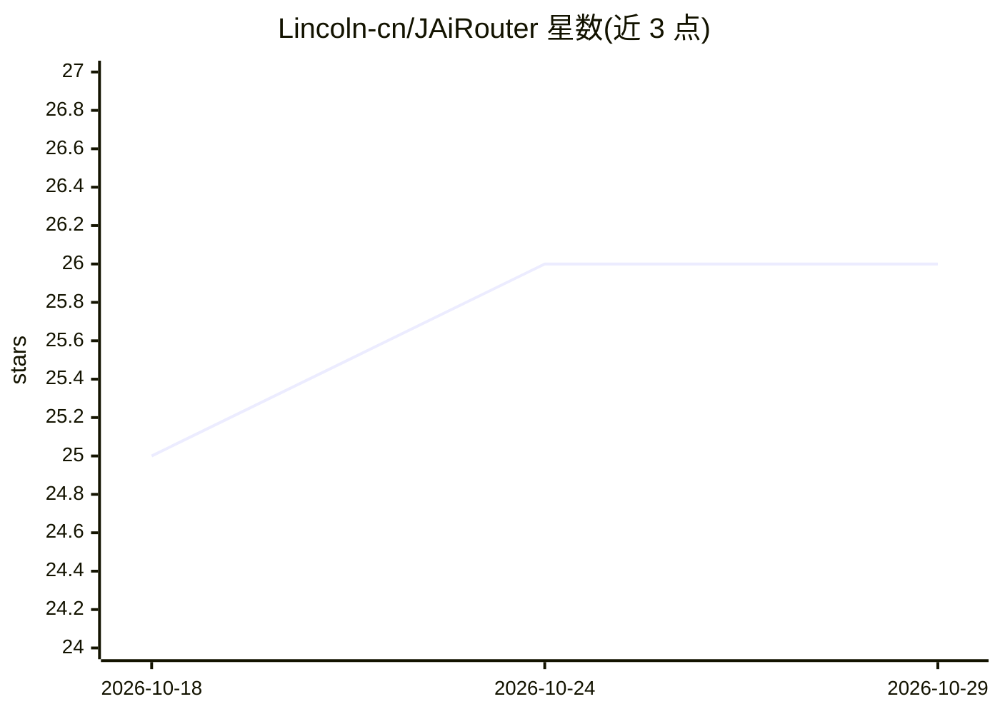

# Lincoln-cn/JAiRouter

⭐ 26 · Java · Apache-2.0 · 推送 2026-10-28 · [GitHub](https://github.com/Lincoln-cn/JAiRouter) · [官网](https://jairouter.com/) · 个人维护 · 中文 README

**自托管 AI 模型网关：统一 OpenAI 兼容端点管理多后端**

面向自建模型服务的 AI 网关：在 Ollama、vLLM、GPUStack、Xinference、LocalAI 及 OpenAI/Anthropic/Gemini 等后端前提供统一 OpenAI 兼容端点，附带 Anthropic Messages 兼容接口。核心能力含 7 种负载均衡、请求级故障转移与熔断、限流、规则路由、多维度配额、RBAC、审计与记录治理（AES-256-GCM 加密）、Prometheus/OpenTelemetry 可观测，全部经 Web 控制台热重载配置。以 Docker 镜像发布，基于 Java/Spring，默认 H2，可选 PostgreSQL/Redis；生产 profile 启动强制 JWT 密钥与管理员密码。

## 筛选速览

| 维度 | 判定 | 备注 |
|---|---|---|
| AI 角色 | `ai-ecosystem` | LLM/agent 周边工具 |
| 许可风险 | `permissive` | Apache-2.0 |
| 部署形态 | `self-host` | docker 或自建部署 |
| 模型依赖 | local-ok | 支持本地模型 |
| 硬件要求 | — | 无带数字的原话,不猜 |
| 安装摩擦 | `low` | 无编译、无系统依赖或容器化 |
| 成熟度 | — | 结构信号不足 |

## 能力要点

- 适配 Ollama/vLLM/GPUStack/Xinference/LocalAI/OpenAI/Anthropic/Gemini 等后端
- 7 种负载均衡策略与请求级故障转移熔断
- 数据驱动 RBAC（63 权限码、4 角色模板）与三级调用记录治理
- Vue 3 控制台热重载配置，多副本部署支持共享限流/配额

## 适用场景

- 把多个本地与云端模型后端统一为一个 OpenAI 兼容 API
- 后端实例故障时自动熔断并请求级转移
- 对团队按角色与配额管控模型调用

## 场景标签

`模型网关` · 领域:Agent 开发

## 证据(README 行号)

> L39: JAiRouter is a **self-hosted AI model gateway**. It puts one OpenAI-compatible endpoint in front of
> L44: It then adds the layer you would otherwise build yourself: multi-instance load balancing, rate

## 星数曲线

2026-10-18 25 → 2026-10-29 26（+1）

---
*卡片 v1 · prompt 1.4 · 生成 2026-10-26 · 置信度 high · 依据 README sha `916f3400690b` · [字段定义](../../DATASET.md)*
