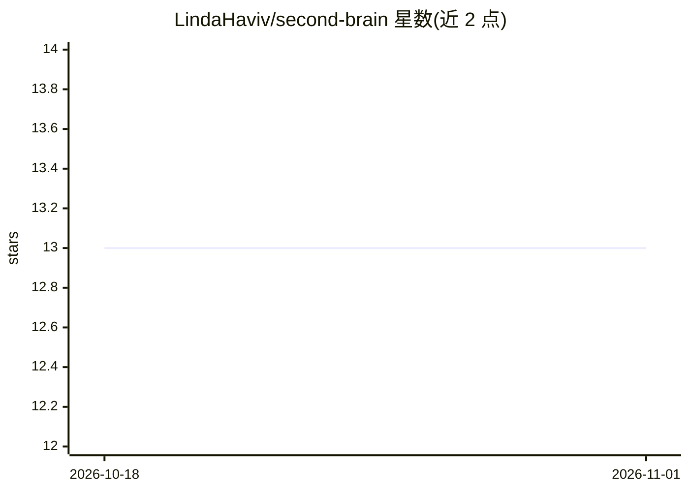

# LindaHaviv/second-brain

⭐ 13 · Python · MIT · 推送 2026-10-28 · [GitHub](https://github.com/LindaHaviv/second-brain) · 个人维护

**基于 Oracle AI 数据库的个人第二大脑：语义搜索+自编译 wiki+agent 记忆**

一步步跟随搭建的个人知识库方案：把 YouTube、Instagram、Notion、ChatGPT/Claude 导出等来源归一化存入 Oracle AI Database 26ai，库内生成嵌入做语义搜索，wiki 编译器自动生成带外键引用的主题页，研究 agent 以 recall→act→verify→record 循环运行并把经验沉淀为 semantic_memory；MCP 服务器把整个大脑接入 claude.ai、ChatGPT 等客户端。LLM 可换 Claude/OpenAI/Ollama，本地运行免费容器，可迁移到 Always Free 云端。面向个人用户，以教程文档形式提供。

## 筛选速览

| 维度 | 判定 | 备注 |
|---|---|---|
| AI 角色 | `ai-native` | 本体是模型或模型工具 |
| 许可风险 | `permissive` | MIT |
| 部署形态 | `self-host` | docker 或自建部署 |
| 模型依赖 | local-ok | 支持本地模型 |
| 硬件要求 | — | 无带数字的原话,不猜 |
| 安装摩擦 | `low` | 无编译、无系统依赖或容器化 |
| 成熟度 | — | 结构信号不足 |

## 能力要点

- in-database 嵌入生成，内容不离开数据库，搜索无需 LLM key
- 自编译 wiki（引用为外键）与四类 agent 记忆、每日 sync 巩固循环
- MCP 服务器（OAuth+白名单）接入 Claude、ChatGPT 等客户端
- visibility 隐私约束过滤所有读取路径

## 适用场景

- 把散落各平台的个人内容汇聚成语义可搜的知识库
- 通过 Claude/ChatGPT 对自己的内容做有据研究问答
- 让 agent 记忆随使用积累，减少重复推导

## 场景标签

`知识库管理` `Agent 记忆` `RAG` `语义搜索` · 领域:Agent 开发

## 证据(README 行号)

> L41: - **Converse** — a Claude agent that researches over your content and writes each run to an
> L47: Full architecture: your sources flow through loaders (normalize, redact, classify, embed in-DB) into one Oracle AI 

## 星数曲线

2026-10-18 13 → 2026-11-01 13（+0）

---
*卡片 v1 · prompt 1.4 · 生成 2026-10-31 · 置信度 mid · 依据 README sha `51560bf1eb1d` · [字段定义](../../DATASET.md)*
