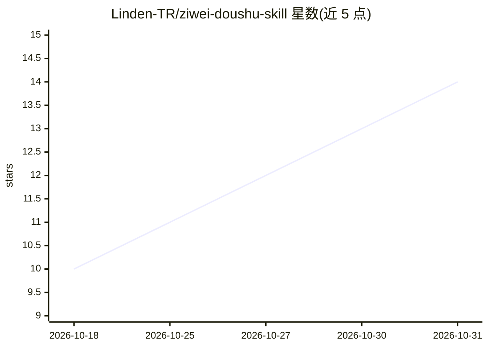

# Linden-TR/ziwei-doushu-skill

⭐ 14 · MIT · 推送 2026-05-27 · [GitHub](https://github.com/Linden-TR/ziwei-doushu-skill) · 个人维护 · 中文 README

**面向 Claude Code 的紫微斗数排盘与命理分析技能包**

为 Claude Code 提供的紫微斗数技能：包含 SKILL.md 与 6 个参考文档（星曜、宫位、四化、45 格局库、时辰真太阳时校正、陆王徵验语料），以中州派为主要方法论，辅以三合、飞星、钦天四化、河洛诸派。排盘等计算依赖 @mingai/mcp 提供的 ziwei、ziwei_horoscope、ziwei_flying_star 三个 MCP 工具。安装方式为 git clone 后复制到 ~/.claude/skills/ 目录，关键词自动触发，输出中文学术风格分析。

## 筛选速览

| 维度 | 判定 | 备注 |
|---|---|---|
| AI 角色 | `ai-knowledge` | 知识聚合/清单类 |
| 许可风险 | `permissive` | MIT |
| 部署形态 | `None` |  |
| 模型依赖 | — | README 未给出锁定关系 |
| 硬件要求 | — | 无带数字的原话,不猜 |
| 安装摩擦 | `low` | 无编译、无系统依赖或容器化 |
| 成熟度 | — | 结构信号不足 |

## 能力要点

- 覆盖十二宫、十四主星、四化、大限的完整排盘与结构化分析流程
- 45 个经典格局库（帝王/文士/事业/财富/特殊/关系）含破格与救应分析
- 中州派为主、四派为辅的多派方法论整合
- 真太阳时校正、夏令时处理与跨时区换算

## 适用场景

- 在 Claude Code 中通过自然语言请求排盘与命理分析
- 查询大限/流年/流月/流日/流时运势
- 追踪宫干四化飞渡与忌转忌/禄转禄路径

## 场景标签

 · 领域:命理/东方玄学知识

## 证据(README 行号)

> L7: > Purple Star Astrology chart reading & destiny analysis skill for Claude Code. Multi-school methodology: Zhongzhou 
> L30: ~/.claude/skills/ziwei-doushu/

## 星数曲线

2026-10-18 10 → 2026-10-31 14（+4）

---
*卡片 v1 · prompt 1.4 · 生成 2026-10-31 · 置信度 high · 依据 README sha `7a3e0052103b` · [字段定义](../../DATASET.md)*
