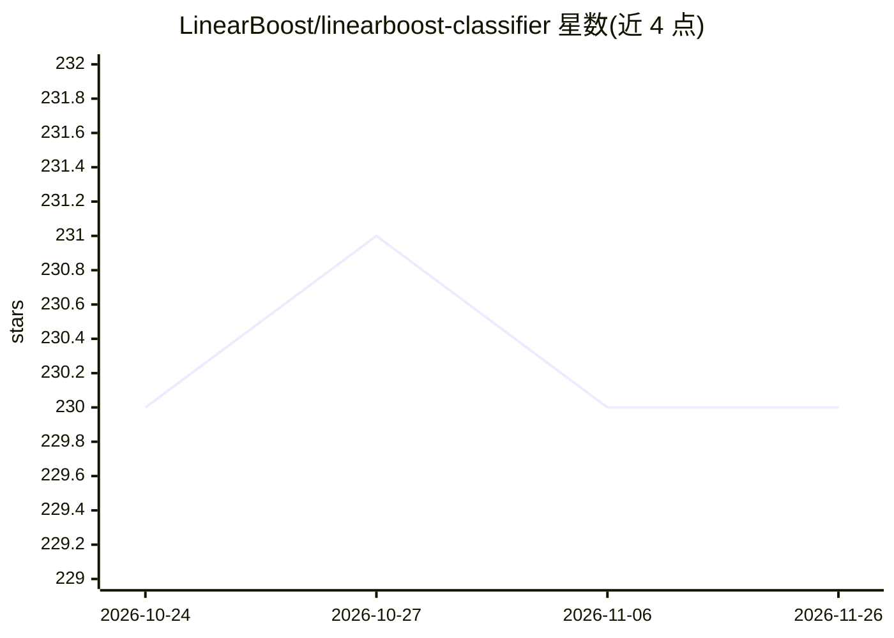

# LinearBoost/linearboost-classifier

⭐ 230 · Jupyter Notebook · MIT · 推送 2026-11-22 · [GitHub](https://github.com/LinearBoost/linearboost-classifier) · 个人维护

**基于 SEFR 线性分类器的快速 boosting 分类 Python 库**

提供 LinearBoostClassifier 与 SEFRBoost 分类/回归估计器：以线性分类器 SEFR 为基学习器，按 AdaBoost（SAMME/SAMME.R）或梯度提升方式顺序训练，支持 rbf/poly/sigmoid 核及 RFF/Nyström 核近似以降低大样本内存开销。提供类别加权、自定义损失、子采样、shrinkage 与早停，接口遵循 scikit-learn 估计器约定，可用于 pipeline 与网格搜索。以 PyPI 包发布，含 Jupyter 演示 notebook 与 readthedocs 文档；类别变量、回归（LinearBoostRegressor）与多输出暂不支持。

## 筛选速览

| 维度 | 判定 | 备注 |
|---|---|---|
| AI 角色 | `ai-native` | 本体是模型或模型工具 |
| 许可风险 | `permissive` | MIT |
| 部署形态 | `library` | 以包/库形式分发 |
| 模型依赖 | — | README 未给出锁定关系 |
| 硬件要求 | — | 无带数字的原话,不猜 |
| 安装摩擦 | `low` | 无编译、无系统依赖或容器化 |
| 成熟度 | — | 结构信号不足 |

## 能力要点

- 以 SEFR 线性分类器为基学习器的 AdaBoost/梯度提升实现
- 支持 RFF 与 Nyström 核近似，实现线性时间复杂度
- 遵循 scikit-learn 估计器 API，可接入 pipeline 与网格搜索
- 内置类别加权、F1 优先加权与早停机制

## 适用场景

- 对表格数据做快速分类建模
- 在不平衡数据集上以 F1 为导向训练分类器
- 大样本场景下用核近似替代完整核矩阵训练非线性分类器

## 场景标签

 · 领域:机器学习/分类算法

## 证据(README 行号)

> L27: LinearBoost is a boosting classifier built on the linear classifier SEFR: it trains SEFR classifiers in sequence wi
> L178: - Both SEFR and LinearBoostClassifier classes are refactored to fully adhere to Scikit-learn's conventions and API

## 星数曲线

2026-10-24 230 → 2026-11-26 230（+0）

---
*卡片 v1 · prompt 1.4 · 生成 2026-11-25 · 置信度 high · 依据 README sha `a459834d9d29` · [字段定义](../../DATASET.md)*
