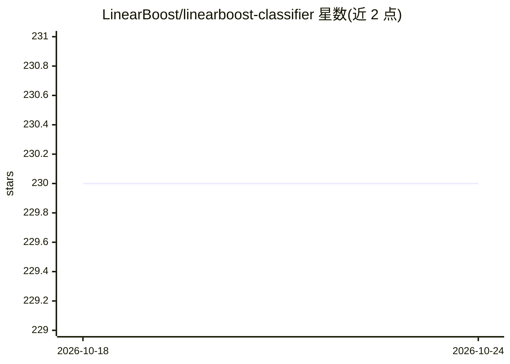

# LinearBoost/linearboost-classifier

⭐ 230 · Jupyter Notebook · MIT · 推送 2026-10-07 · [GitHub](https://github.com/LinearBoost/linearboost-classifier) · 组织维护

**基于线性分类器 SEFR 的 boosting 分类算法库**

Python 实现的机器学习分类算法包：LinearBoost 在线性分类器 SEFR 之上做 AdaBoost（SAMME/SAMME.R）或梯度提升，支持线性/多项式/RBF/Sigmoid 核及 RFF、Nyström 核近似，提供类权重、子采样、shrinkage、早停与 F1 导向的不平衡数据加权机制；v0.2.0 新增 SEFRBoostClassifier/Regressor（树节点内嵌 SEFR 线性分裂的梯度提升）。两个类遵循 Scikit-learn 估计器规范，可入 pipeline 与网格搜索。供需要在 sklearn 工作流中使用快速分类器的开发者使用。

## 筛选速览

| 维度 | 判定 | 备注 |
|---|---|---|
| AI 角色 | `ai-native` | 本体是模型或模型工具 |
| 许可风险 | `permissive` | MIT |
| 部署形态 | `library` | 以包/库形式分发 |
| 模型依赖 | — | README 未给出锁定关系 |
| 硬件要求 | — | 无带数字的原话,不猜 |
| 安装摩擦 | `low` | 无编译、无系统依赖或容器化 |
| 成熟度 | — | 结构信号不足 |

## 能力要点

- LinearBoostClassifier 支持 AdaBoost 与梯度提升两种模式
- 四种核及 RFF/Nyström 近似（线性时间复杂度）
- SEFRBoost：树节点用 SEFR 超平面分裂的斜切 GBDT 变体
- 完全遵循 Scikit-learn 估计器规范，可用于 pipeline 与网格搜索

## 适用场景

- 在 sklearn 工作流中训练 boosting 分类器
- 低内存占用场景下处理大规模数据的非线性分类
- 不平衡数据集上做以 F1 为导向的分类

## 场景标签

 · 领域:机器学习/分类算法

## 证据(README 行号)

> L20: - Train `LinearBoostClassifier`
> L48: from linearboost import SEFRBoostClassifier, SEFRBoostRegressor

## 星数曲线

2026-10-18 230 → 2026-10-24 230（+0）

---
*卡片 v1 · prompt 1.4 · 生成 2026-10-22 · 置信度 high · 依据 README sha `15e05bf47b14` · [字段定义](../../DATASET.md)*
