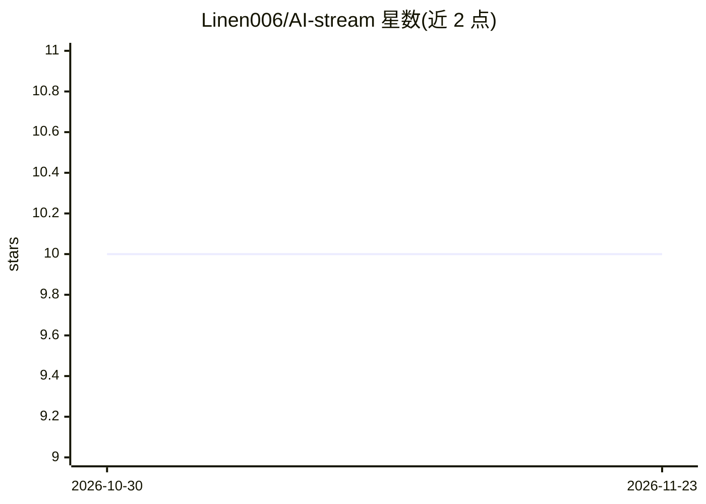

# Linen006/AI-stream

⭐ 10 · Python · MIT · 推送 2026-09-19 · [GitHub](https://github.com/Linen006/AI-stream) · 个人维护 · 中文 README

**给短视频电商运营者：AI 生成脚本分镜并复盘投流数据的工作流**

输入商品名称后，AI 依次完成卖点分析、生成 3 个内容角度、输出 30 秒脚本分镜与质检清单，结果回写 CSV 与 SQLite；发布后读取投流数据计算 ROI/CTR 等指标并生成 AI 复盘报告，结论沉淀到提示词知识库（可检索、可版本管理）。提供 WebUI、JSON API、CLI 三种入口，后台任务队列异步执行 AI 调用。支持 MOCK_AI=true 离线演示，无需 API Key；接入 DeepSeek API（OpenAI 兼容、可替换）。

## 筛选速览

| 维度 | 判定 | 备注 |
|---|---|---|
| AI 角色 | `ai-native` | 本体是模型或模型工具 |
| 许可风险 | `permissive` | MIT |
| 部署形态 | `library` | 以包/库形式分发 |
| 模型依赖 | locked-api |  |
| 硬件要求 | — | 无带数字的原话,不猜 |
| 安装摩擦 | `low` | 无编译、无系统依赖或容器化 |
| 成熟度 | — | 结构信号不足 |

## 能力要点

- 四步 AI 工作流：卖点分析→内容角度→脚本分镜→质检发布，输出结构化校验缺失自动重试
- WebUI / JSON API / CLI 三端共用一套业务层，结果真实回写 SQLite（8 张外键关联表）
- 读取投流数据自动计算 ROI/CTR/转化率并生成 AI 复盘报告，结论沉淀回知识库
- MOCK_AI=true 免 API Key 完整跑通离线演示

## 适用场景

- 为商品批量生成短视频脚本分镜和发布标题
- 读取投放数据让 AI 出复盘报告，反哺下轮内容
- 搭建 AI 内容运营岗位的工程化演示或面试项目
- 通过 JSON API 把脚本生成流程集成到自有系统

## 场景标签

`工作流自动化` `AI 写作` · 领域:效率与自动化

## 证据(README 行号)

> L3: 输入一个商品，AI 自动完成 **卖点分析 → 内容角度 → 30 秒脚本分镜 → 质检清单**，
> L26: 🎯 数据闭环 | 工作流、脚本助手、复盘结果全部真实回写 SQLite，不是演示玩具
> L109: |大模型|DeepSeek API（OpenAI 兼容，可替换）|

## 星数曲线

2026-10-30 10 → 2026-11-23 10（+0）

---
*卡片 v1 · prompt 1.4 · 生成 2026-11-20 · 置信度 high · 依据 README sha `97760ee0781c` · [字段定义](../../DATASET.md)*
