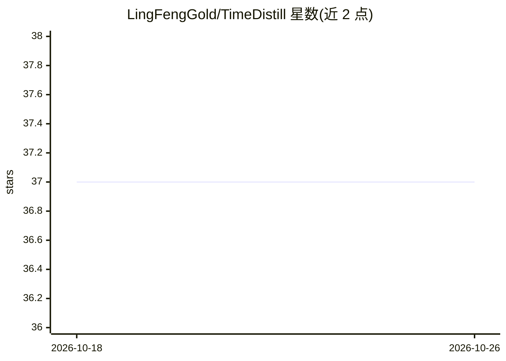

# LingFengGold/TimeDistill

⭐ 37 · Python · Apache-2.0 · 推送 2026-03-22 · [GitHub](https://github.com/LingFengGold/TimeDistill) · [官网](https://arxiv.org/abs/2502.15016) · 组织维护 · 中文 README

**KDD'26 论文官方实现：跨架构蒸馏让 MLP 做长期时序预测**

TimeDistill 的官方代码实现（KDD'26，arXiv:2502.15016）。它是一个知识蒸馏框架：先训练 Transformer/CNN 教师（iTransformer、ModernTCN、TimeMixer、PatchTST 等 8 种），再将时域与频域模式蒸馏给轻量 MLP 学生。两个模块：多尺度蒸馏（多粒度下采样并对齐师生尺度）与多周期蒸馏（FFT 转频谱后匹配周期分布）。论文报告在八个数据集上超越教师模型，速度最多提升 7 倍、参数减少 130 倍。通过 pip/conda 安装依赖、bash 脚本训练；仅在 A100（CUDA 12.8）上测试过。面向时序预测研究者。

## 筛选速览

| 维度 | 判定 | 备注 |
|---|---|---|
| AI 角色 | `ai-native` | 本体是模型或模型工具 |
| 许可风险 | `permissive` | Apache-2.0 |
| 部署形态 | `desktop` | 安装包/桌面程序 |
| 模型依赖 | — | README 未给出锁定关系 |
| 硬件要求 | — | 无带数字的原话,不猜 |
| 安装摩擦 | `medium` | 含编译或系统依赖之一 |
| 成熟度 | — | 结构信号不足 |

## 能力要点

- 多尺度蒸馏：多粒度下采样并在师生间对齐
- 多周期蒸馏：FFT 频谱 + softmax 匹配周期分布
- 支持 8 种教师模型（iTransformer/ModernTCN/TimeMixer/PatchTST 等）
- 论文报告：MLP 性能最多提升 18.6%，速度快 7 倍，参数少 130 倍

## 适用场景

- 复现 KDD'26 TimeDistill 论文实验
- 训练轻量 MLP 做长期时序预测
- 研究跨架构知识蒸馏方法在时序任务上的应用

## 场景标签

 · 领域:时间序列预测/机器学习

## 证据(README 行号)

> L1: (KDD'26) TimeDistill: Efficient Long-Term Time Series Forecasting with MLPs via Cross-Architecture Distillation
> L22: Transformer and CNN models perform well in long-term time series forecasting but are resource-intensive. TimeDistil
> L27: TimeDistill improves MLP performance by up to 18.6%, surpasses teacher models on eight datasets, runs up to 7× fast

## 星数曲线

2026-10-18 37 → 2026-10-26 37（+0）

---
*卡片 v1 · prompt 1.4 · 生成 2026-10-25 · 置信度 mid · 依据 README sha `3a4e04faec14` · [字段定义](../../DATASET.md)*
