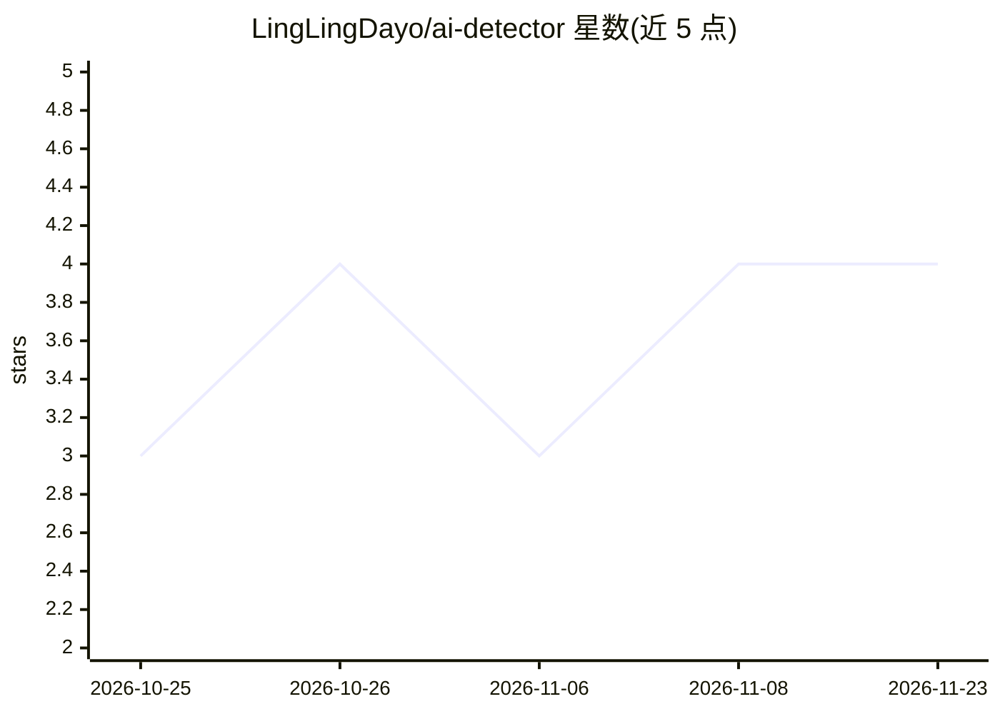

# LingLingDayo/ai-detector

⭐ 4 · TypeScript · MIT · 推送 2026-11-16 · [GitHub](https://github.com/LingLingDayo/ai-detector) · 个人维护 · 中文 README

**给开发者的 LLM API 真实性鉴别桌面客户端**

基于 Tauri v2 与 Vue 3 构建的桌面客户端，面向大语言模型 API 用户，用于核验所调用接口背后的模型是否与宣称一致。内置四种测试：向目标 API 发送题库探针并以 Hellinger 距离比对指纹、请求生成 SVG 矢量图形做视觉检验、动态生成长链逻辑题由后端判定、以及自由对话与响应头路由/延迟/吞吐诊断。探针题库来自上游 ModelTrace，可通过内置脚本在线同步；README 声明结果基于统计比对，仅供参考。

## 筛选速览

| 维度 | 判定 | 备注 |
|---|---|---|
| AI 角色 | `ai-ecosystem` | LLM/agent 周边工具 |
| 许可风险 | `permissive` | MIT |
| 部署形态 | `library` | 以包/库形式分发 |
| 模型依赖 | — | README 未给出锁定关系 |
| 硬件要求 | — | 无带数字的原话,不猜 |
| 安装摩擦 | `low` | 无编译、无系统依赖或容器化 |
| 成熟度 | — | 结构信号不足 |

## 能力要点

- 探针指纹比对：3 道挑战题采集统计行为指纹，与基准模型库比对 Hellinger 距离
- 鹈鹕/SVG 视觉测试与长链逻辑糖果测试两种甄别降智模型的方式
- 连接测试核验响应头路由一致性，统计首字延迟、Tokens/s 与缓存读写
- 内置 npm 脚本一键同步上游 ModelTrace 指纹题库

## 适用场景

- 使用 API 中转/聚合平台时核验模型是否货不对板
- 检测接口背后的模型是否存在降级或参数缩水
- 测试接口的流式稳定性、延迟与上下文承载能力

## 场景标签

`模型评测` · 领域:评测与运维

## 证据(README 行号)

> L13: **AI 模型检测器 (AI Detector)** 是一款专为大语言模型（LLM）API 设计的真实性验证桌面客户端。
> L15: 随着各类大模型 API 中转服务与聚合平台的普及，市场上存在部分服务商为了降低成本，对模型进行“掺水”、“降级”甚至“货不对板”的伪造行为。本项目提供**模型探针测试**、**鹈鹕视觉测试**、**糖果逻辑测试**与**连接测试*

## 星数曲线

2026-10-25 3 → 2026-11-23 4（+1）

---
*卡片 v1 · prompt 1.4 · 生成 2026-11-21 · 置信度 high · 依据 README sha `368c4f30dbe9` · [字段定义](../../DATASET.md)*
