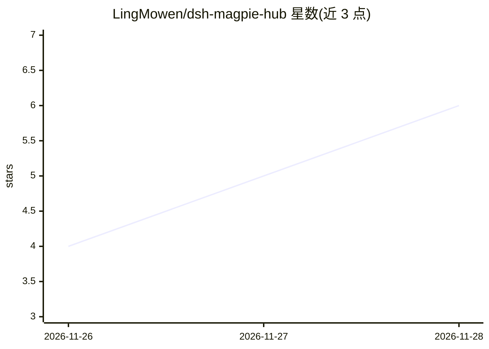

# LingMowen/dsh-magpie-hub

⭐ 6 · JavaScript · AGPL-3.0 · 推送 2026-11-27 · [GitHub](https://github.com/LingMowen/dsh-magpie-hub) · 个人维护 · 中文 README

**让 DSH 用户在 DeepSeek Harness 内直接运行 magpie 供应商插件**

DeepSeek Harness（DSH）的插件：实现 magpie 插件协议的宿主，使为 magpie 写的供应商插件（登录/列模型/请求转发/额度/签到/商店安装）不改代码即可在 DSH 内运行。它不安装 magpie 桌面程序，而是读写 magpie 的数据目录以继承已装插件与登录态；桌面端托管 magpie 原版 Web UI，手机端通过 dsh-Go 原生面板提供五个页签。纯 ESM、无可编译步骤，运行环境要求 Node ^22.19.0 或 >=24，AGPL-3.0 许可。git spec 插件不自动安装，Windows DPAPI 加密凭据跨系统需重新登录。

## 筛选速览

| 维度 | 判定 | 备注 |
|---|---|---|
| AI 角色 | `ai-ecosystem` | LLM/agent 周边工具 |
| 许可风险 | `viral` | AGPL-3.0 |
| 部署形态 | `None` |  |
| 模型依赖 | — | README 未给出锁定关系 |
| 硬件要求 | — | 无带数字的原话,不猜 |
| 安装摩擦 | `low` | 无编译、无系统依赖或容器化 |
| 成熟度 | — | 结构信号不足 |

## 能力要点

- 在 DSH 进程内运行 magpie 供应商插件，无需安装 magpie 桌面程序
- 读写 magpie 数据目录，继承已装插件与登录账号
- 请求转发支持 OpenAI 兼容 / Anthropic / Gemini 三套 SDK 协议
- 桌面 Web UI 与手机 dsh-Go 原生面板双端共用同一份数据

## 适用场景

- 在 DSH 环境中使用 magpie 插件生态接入国内外 AI 平台
- 在手机上登录各平台账号并查看额度窗口与用量流水
- 在面板中管理已装插件的启停、更新与商店安装

## 场景标签

`模型网关` · 领域:Agent 开发

## 证据(README 行号)

> L3: 在 **DeepSeek Harness（DSH）进程内**直接运行 magpie 的供应商插件：登录、列模型、转发请求、看额度、签到、装插件。桌面与手机共用同一份数据。
> L16: magpie 的价值在**插件生态**——一批国内外 AI 平台各自提供了供应商插件。那些插件是普通 ESM 模块，导出一个函数、返回一组钩子——本插件在 DSH 里实现这些钩子的宿主，于是**为 magpie 写的插件不改一行就
> L21: |模型进 DSH|每个 provider 注册成 DSH 的一条模型路由|

## 星数曲线

2026-11-26 4 → 2026-11-28 6（+2）

---
*卡片 v1 · prompt 1.4 · 生成 2026-11-26 · 置信度 high · 依据 README sha `a35d93440797` · [字段定义](../../DATASET.md)*
