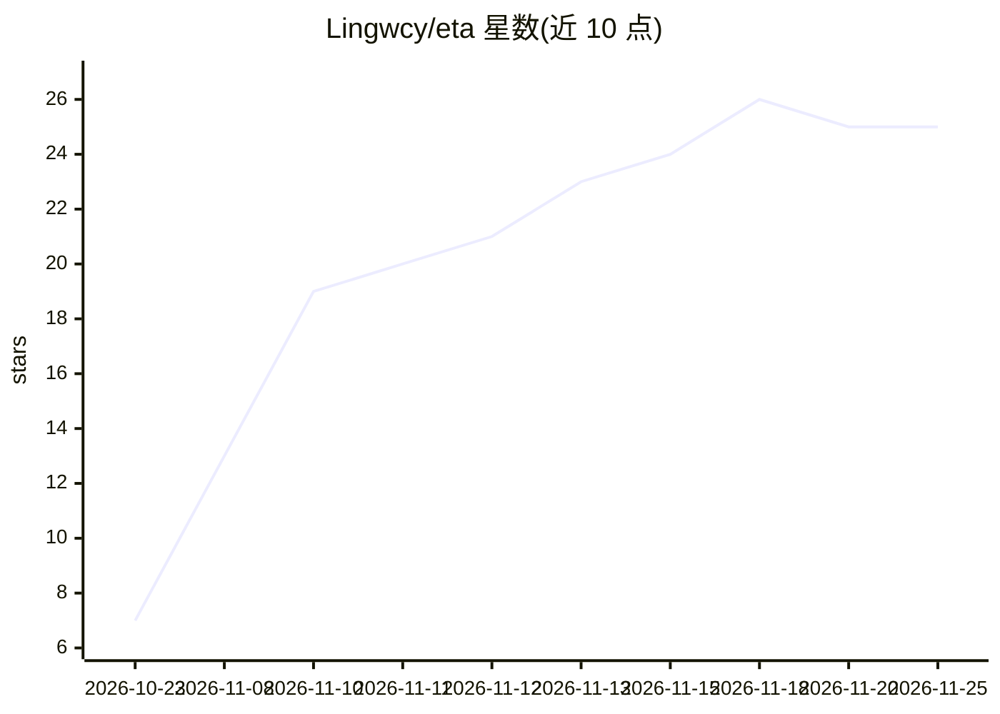

# Lingwcy/eta

⭐ 25 · TypeScript · MIT · 推送 2026-11-22 · [GitHub](https://github.com/Lingwcy/eta) · [官网](https://eta-olive-six.vercel.app/) · 个人维护 · 中文 README

**桌面与自托管云端的开源个人 agent，支持持久会话与定时任务**

开源个人通用 agent，形态覆盖三处：macOS/Windows 的 Electron 桌面客户端、自托管 Bot 云服务器（HTTP/SSE 暴露 agent、含 Discord 接入）、以及 iOS/Android 手机伴侣端，用于移动审批。共享核心提供项目、持久会话线程、沙箱、调度与审批机制；agent 运行时基于 Earendil Works 的 Pi 最小化 harness。用户接入自有 AI 账号或 API key。限制：Windows 安装包未签名、Windows 不支持受限沙箱执行、本地命令执行需 Git for Windows。

## 筛选速览

| 维度 | 判定 | 备注 |
|---|---|---|
| AI 角色 | `ai-native` | 本体是模型或模型工具 |
| 许可风险 | `permissive` | MIT |
| 部署形态 | `None` |  |
| 模型依赖 | — | README 未给出锁定关系 |
| 硬件要求 | — | 无带数字的原话,不猜 |
| 安装摩擦 | `low` | 无编译、无系统依赖或容器化 |
| 成熟度 | — | 结构信号不足 |

## 能力要点

- 桌面端 + 自托管 Bot + 移动伴侣三端共享持久会话与定时任务
- agent 运行时构建于 Pi harness，支持工具调用与会话管理
- 沙箱执行、审批机制与技能/子代理等能力

## 适用场景

- 在桌面上让个人 agent 处理本地项目工作
- 关闭电脑后由自托管 Bot 继续运行任务
- 在手机上远程批准 agent 发起的操作

## 场景标签

`AI 助手` · 领域:对话与助手

## 证据(README 行号)

> L11:  A general-purpose agent for your desktop — and your cloud.
> L16: Instead of locking you into one vendor or one window, Eta takes the shape of your workflow — your models, your loca

## 星数曲线

2026-10-23 7 → 2026-11-25 25（+18）

---
*卡片 v1 · prompt 1.4 · 生成 2026-11-18 · 置信度 high · 依据 README sha `aa76ed4a0168` · [字段定义](../../DATASET.md)*
