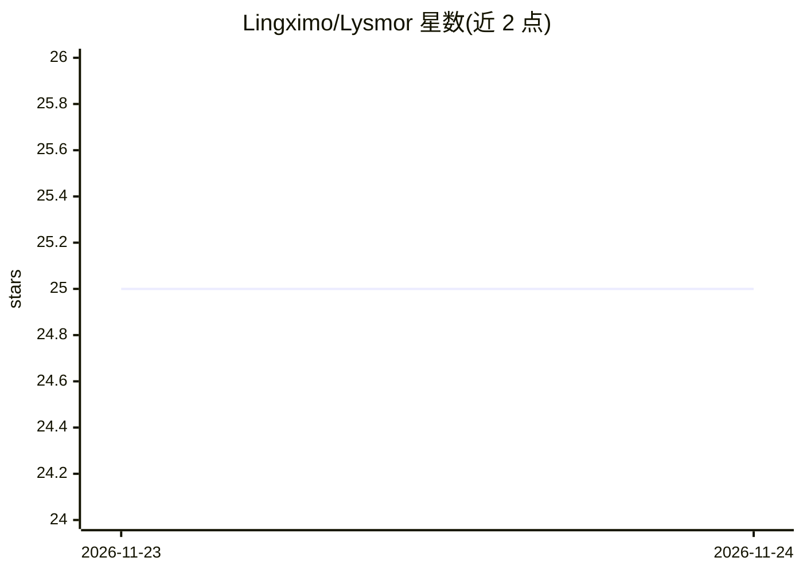

# Lingximo/Lysmor

⭐ 25 · Python · AGPL-3.0 · 推送 2026-11-22 · [GitHub](https://github.com/Lingximo/Lysmor) · 个人维护 · 中文 README

**可自托管的 AI 伴侣系统：长期记忆、情绪模拟与多端界面**

Lysmor 将 AI 伴侣系统拆成可复用模块：长期记忆库（文档+向量检索+图记忆，按重要度/相关度/时间召回）、情绪与生理状态层、多端界面（网页聊天/视频通话+Live2D/生命面板/记忆星图/3D 房间等），并提供整包备份与换机恢复工具（tools/nirvana）。数据全部本地存放，不依赖云端。运行需 Windows 10/11、Python 3.12、Ollama 本地模型、AstrBot、ffmpeg 及 DeepSeek API Key，提供可视化装机向导与一键配置脚本。

## 筛选速览

| 维度 | 判定 | 备注 |
|---|---|---|
| AI 角色 | `ai-native` | 本体是模型或模型工具 |
| 许可风险 | `viral` | AGPL-3.0 |
| 部署形态 | `None` |  |
| 模型依赖 | local-ok | 支持本地模型 |
| 硬件要求 | — | 无带数字的原话,不猜 |
| 安装摩擦 | `medium` | 含编译或系统依赖之一 |
| 成熟度 | — | 结构信号不足 |

## 能力要点

- 长期记忆库：文档+向量检索+图记忆，支持快照与去重
- 多端界面：聊天/视频通话/Live2D/记忆星图/3D 房间
- 灾后复活工具：整包备份+分片上传+一键恢复
- 本地模型经 Ollama 运行（qwen3-vl:4b、bge-m3），数据不出本地

## 适用场景

- 在自己电脑上搭建一个有长期记忆的 AI 伴侣
- 通过 QQ 与角色聊天，视频通话中看到 Live2D 形象
- 换电脑时一键恢复整套角色数据与配置

## 场景标签

`AI 助手` `聊天机器人` `Agent 记忆` · 领域:Agent 开发

## 证据(README 行号)

> L7: **可自托管的 AI 伴侣系统（开源参考实现）。**
> L41: - Ollama（本地模型：视觉 `qwen3-vl:4b`、向量 `bge-m3`）
> L44: - 一个 DeepSeek API Key（`platform.deepseek.com`）

## 星数曲线

2026-11-23 25 → 2026-11-24 25（+0）

---
*卡片 v1 · prompt 1.4 · 生成 2026-11-23 · 置信度 high · 依据 README sha `ca0860fe4c09` · [字段定义](../../DATASET.md)*
