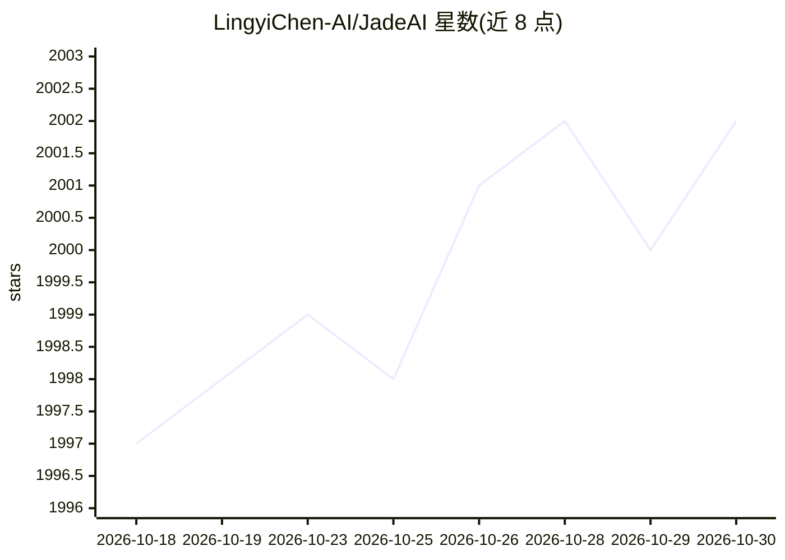

# LingyiChen-AI/JadeAI

⭐ 2,002 · TypeScript · Apache-2.0 · 推送 2026-10-23 · [GitHub](https://github.com/LingyiChen-AI/JadeAI) · [官网](https://jadeai.cturing.cn/en) · 个人维护 · 中文 README

**面向求职者的 AI 简历构建器：AI 生成/优化/JD 匹配/模拟面试**

基于 Next.js/React 的开源简历构建应用：拖拽编辑、50 套模板、Markdown 支持、PDF/DOCX/HTML/JSON 多格式导出与链接分享。AI 能力包括简历生成、PDF/图片解析、JD 匹配分析、求职信生成、语法检查、10 语言翻译，以及 6 种角色的模拟面试与评分报告。AI 密钥由用户在应用内自配，支持 OpenAI、Anthropic 及任意 OpenAI 兼容端点。提供 Docker 一键部署和 macOS/Windows 桌面客户端，桌面版数据存本地 SQLite。

## 筛选速览

| 维度 | 判定 | 备注 |
|---|---|---|
| AI 角色 | `ai-native` | 本体是模型或模型工具 |
| 许可风险 | `permissive` | Apache-2.0 |
| 部署形态 | `desktop` | 安装包/桌面程序 |
| 模型依赖 | — | README 未给出锁定关系 |
| 硬件要求 | — | 无带数字的原话,不猜 |
| 安装摩擦 | `low` | 无编译、无系统依赖或容器化 |
| 成熟度 | — | 结构信号不足 |

## 能力要点

- AI 简历生成与 PDF/图片简历解析
- JD 匹配分析：关键词匹配、ATS 评分与改进建议
- 6 种预设角色的模拟面试与能力雷达图报告
- 桌面客户端：免部署、无账号、数据本地存储

## 适用场景

- 用 AI 根据职位与经历生成并优化简历
- 对照 JD 检查简历匹配度并获取改进建议
- 通过 AI 模拟面试练习并查看评分报告

## 场景标签

`AI 写作` · 领域:内容生成

## 证据(README 行号)

> L133: - **AI Resume Generation** — Generate a complete resume from job title, experience, and skills
> L134: - **Resume Parsing** — Upload an existing PDF or image, AI extracts all content automatically
> L143: - **JD-Based Interview Simulation** — Paste a job description, AI plays different interviewer roles in sequence

## 星数曲线

2026-10-18 1,997 → 2026-10-30 2,002（+5）

---
*卡片 v1 · prompt 1.4 · 生成 2026-10-21 · 置信度 mid · 依据 README sha `491d27b61c74` · [字段定义](../../DATASET.md)*
