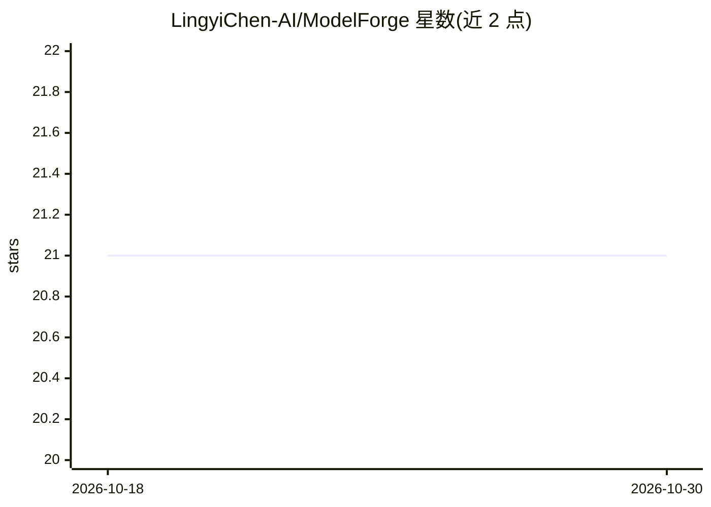

# LingyiChen-AI/ModelForge

⭐ 21 · Python · Apache-2.0 · 推送 2026-06-22 · [GitHub](https://github.com/LingyiChen-AI/ModelForge) · 个人维护 · 中文 README

**小团队 NLP 小模型一站式平台：数据·训练·评估·部署·Badcase 闭环**

面向小团队内部使用的 BERT 类编码器模型训练与服务平台（明确不做大模型微调、不做图像）：提供数据集/评估集版本管理（parquet 快照+checksum）、四类任务（classification/ner/pair/embedding）微调训练、评估与模型版本管理、在线推理部署（/predict、/embed、/similarity），以及 Badcase 回流再训练闭环。另内置大模型 Prompt 盲测评测：调用外部 LLM API（OpenAI 协议）做人工盲测 + AI 自动评估双指标，但不微调大模型。架构为 app-server/ml-worker/model-server/前端四组件，基础设施用 PG/Redis/MinIO/MLflow，源码安装 + docker compose 启动基础设施。

## 筛选速览

| 维度 | 判定 | 备注 |
|---|---|---|
| AI 角色 | `ai-ecosystem` | LLM/agent 周边工具 |
| 许可风险 | `permissive` | Apache-2.0 |
| 部署形态 | `self-host` | docker 或自建部署 |
| 模型依赖 | — | README 未给出锁定关系 |
| 硬件要求 | — | 无带数字的原话,不猜 |
| 安装摩擦 | `low` | 无编译、无系统依赖或容器化 |
| 成熟度 | — | 结构信号不足 |

## 能力要点

- 四类 task_type（分类/NER/句对/embedding）训练 recipe 与评估器
- 数据集不可变版本快照（parquet+sha256）保证训练可复现
- Badcase 上报→标注工作台→生成训练集回流再训练，统计 badcase_fix_rate
- Prompt 盲测评测：隐藏版本固定 A/B/C，人工 + AI 双套指标

## 适用场景

- 小团队在自己数据上微调 BERT/嵌入模型并在线部署
- 线上坏例回传标注后回流再训练形成闭环
- 对比不同 Prompt 版本与大模型效果（盲测人工+AI 评估）
- 同一评估集上横向对比多个模型版本

## 场景标签

`微调` `模型评测` `MLOps` · 领域:评测与运维

## 证据(README 行号)

> L7: 小团队内部使用的 **NLP 模型训练与服务平台**,围绕 BERT 架构类编码器模型(**不做大模型微调,不做图像**)。提供训练集/评估集管理与版本管理、训练流程、评估流程、模型版本管理、在线推理部署,以及面向大模型应用的 **
> L25: - **训练流程**:按 `task_type` 分流 recipe(classification / ner / pair / embedding 均已落地),实验与产物记录到 MLflow。提交时先选基础模型(BERT / B
> L30: - **大模型 Prompt 评测**:配置 **LLM 供应商/模型**(OpenAI 协议,`llm:manage`)→ 管理带 `{{ 参数 }}` 的 **Prompt 版本**(不可变,`prompt:read/writ

## 星数曲线

2026-10-18 21 → 2026-10-30 21（+0）

---
*卡片 v1 · prompt 1.4 · 生成 2026-10-28 · 置信度 mid · 依据 README sha `2c91c4746444` · [字段定义](../../DATASET.md)*
