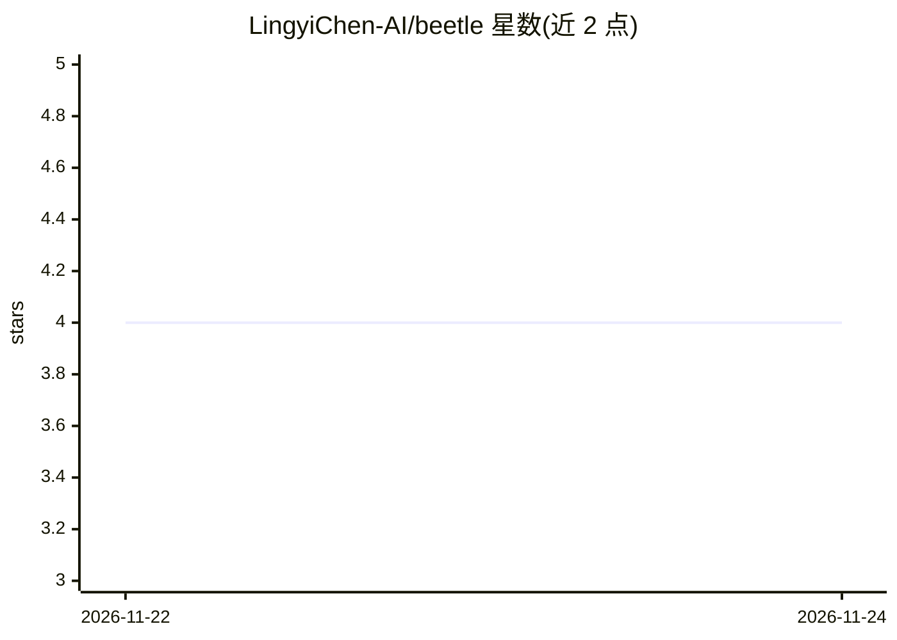

# LingyiChen-AI/beetle

⭐ 4 · Rust · AGPL-3.0 · 推送 2026-11-22 · [GitHub](https://github.com/LingyiChen-AI/beetle) · 个人维护 · 中文 README

**把飞书群里 @ 机器人的问题交给本机 Claude Code/Codex 处理的托盘客户端**

基于 Tauri（Rust + Web 前端）的常驻系统托盘桌面客户端：飞书群 @ 机器人的问题由本机 Claude Code 或 Codex CLI 处理，内置「查 bug」流程（读取群聊上下文→同步 release 代码→只读查询数据源→输出根因与修复建议），支持 PR 自动代码审查、结果写入 Gitee/GitHub issue 或飞书文档。数据源直连 MySQL/PostgreSQL/MongoDB，客户端强制只读并记录审计；密钥存系统凭据库。运行依赖 Claude Code 或 Codex CLI、Python 3.10+、Git、lark-cli。Windows 支持，macOS 适配进行中。

## 筛选速览

| 维度 | 判定 | 备注 |
|---|---|---|
| AI 角色 | `ai-native` | 本体是模型或模型工具 |
| 许可风险 | `viral` | AGPL-3.0 |
| 部署形态 | `library` | 以包/库形式分发 |
| 模型依赖 | locked-api |  |
| 硬件要求 | — | 无带数字的原话,不猜 |
| 安装摩擦 | `low` | 无编译、无系统依赖或容器化 |
| 成熟度 | — | 结构信号不足 |

## 能力要点

- Claude Code / Codex 双引擎，每个机器人可单独选择
- 查 bug 流程：群聊上下文→代码同步→只读数据源查询→根因建议
- 客户端强制只读查询：拦截危险函数、自动补 LIMIT、每次查询记审计
- 环境检查与一键安装，技能中心一键安装内置技能

## 适用场景

- 在飞书群里 @ 机器人排查线上 bug 并获得根因分析
- 群里发 PR 链接自动触发按语言规则的代码审查
- 把排查结果一键记录为 Gitee/GitHub issue 或飞书文档

## 场景标签

`代码审查` `编码 Agent` · 领域:编码与开发

## 证据(README 行号)

> L3: 常驻系统托盘的桌面客户端：把飞书群里 @ 机器人的问题，交给本机的 Claude Code / Codex 处理，内置「查 bug」流程。
> L11: - **查 bug 流程**：读取群聊上下文 → 同步最新 release 代码 → 只读查询项目关联的数据源 → 给出根因与修复建议。
> L47: - Claude Code 或 Codex CLI（至少一个）

## 星数曲线

2026-11-22 4 → 2026-11-24 4（+0）

---
*卡片 v1 · prompt 1.4 · 生成 2026-11-22 · 置信度 mid · 依据 README sha `112921c0d162` · [字段定义](../../DATASET.md)*
