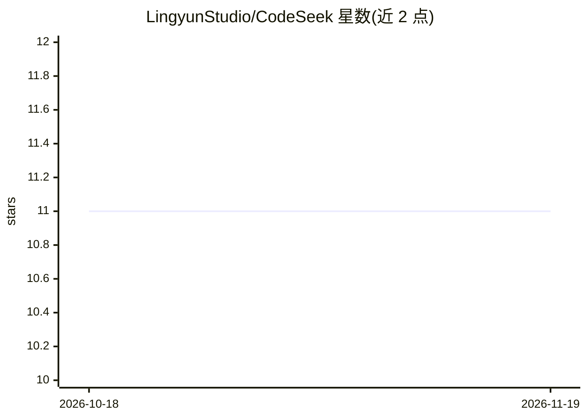

# LingyunStudio/CodeSeek

⭐ 11 · Go · GPL-3.0 · 推送 2026-09-14 · [GitHub](https://github.com/LingyunStudio/CodeSeek) · 个人维护 · 中文 README

**让 Codex CLI 使用 DeepSeek 模型的本地协议转换代理**

在本地启动 HTTP 服务（默认 127.0.0.1:38440），将 Codex 发出的 OpenAI Responses API 请求转换为 Anthropic Messages API 格式转发到 DeepSeek，返回时再转换回 OpenAI 格式。提供桌面 GUI（服务启停、API Key 管理、日志查看）与 CLI 两种模式，支持多 provider/多模型路由、DeepSeek reasoning_content 处理、Codex 自动配置注入并在停止时恢复。提供 macOS dmg 与 Windows 安装包，亦可用 Docker 运行。README 声明项目已不再维护，推荐使用 CC Switch。

## 筛选速览

| 维度 | 判定 | 备注 |
|---|---|---|
| AI 角色 | `ai-ecosystem` | LLM/agent 周边工具 |
| 许可风险 | `viral` | GPL-3.0 |
| 部署形态 | `desktop` | 安装包/桌面程序 |
| 模型依赖 | locked-api |  |
| 硬件要求 | — | 无带数字的原话,不猜 |
| 安装摩擦 | `low` | 无编译、无系统依赖或容器化 |
| 成熟度 | — | 结构信号不足 |

## 能力要点

- OpenAI Responses API ↔ Anthropic Messages API 协议转换
- 多 provider、多模型路由与 DeepSeek V4 适配（reasoning_content/thinking block）
- 桌面 GUI 与 CLI 双模式，自动注入 Codex base_url 与 model catalog
- 提供 macOS/Windows 安装包与 Docker 部署方式

## 适用场景

- 在 Codex CLI 中接入 DeepSeek 模型进行编码任务
- 本地管理 API Key 与代理服务的启停和日志
- 通过 Docker 在服务器环境部署协议转换服务

## 场景标签

`模型网关` · 领域:Agent 开发

## 证据(README 行号)

> L5: 让 Codex CLI 使用 DeepSeek 模型的协议转换代理。
> L7: **工作原理：** CodeSeek 在本地启动一个 HTTP 服务（`127.0.0.1:38440`），将 Codex 发出的 OpenAI Responses API 请求转换为 Anthropic Messages API 
> L107: - 协议转换：OpenAI Responses API ↔ Anthropic Messages API

## 星数曲线

2026-10-18 11 → 2026-11-19 11（+0）

---
*卡片 v1 · prompt 1.4 · 生成 2026-11-19 · 置信度 high · 依据 README sha `b79116476018` · [字段定义](../../DATASET.md)*
