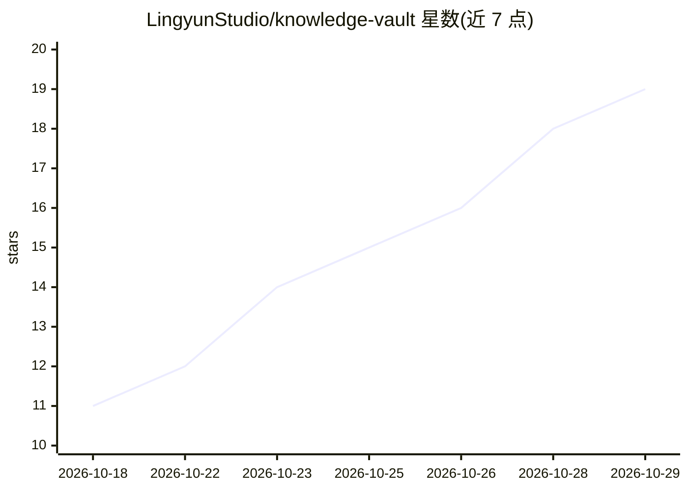

# LingyunStudio/knowledge-vault

⭐ 19 · TypeScript · 推送 2026-10-04 · [GitHub](https://github.com/LingyunStudio/knowledge-vault) · 组织维护 · 中文 README

**本地优先的所见即所得 Markdown 知识库与学习工作台**

基于 Tauri 2（Rust）+ React 19 + Milkdown/ProseMirror 的桌面知识库应用：在渲染后的排版上直接编辑，1.2 秒静止后自动写回 Markdown，无源码视图与模式切换。内容为带 YAML front matter 的标准 Markdown 文件。提供回收站、历史版本、原子保存与冲突检测、间隔重复复习卡、全文检索、手动备份恢复。AI 功能包括置顶小窗问答（结合本地关键词检索来源、一键保存为笔记）与写作模板；默认不内置模型，用户手动添加供应商，支持 OpenAI 兼容/Anthropic 兼容/Gemini 等 90 家预设。AI 会话来源检索为关键词匹配，无向量索引。

## 筛选速览

| 维度 | 判定 | 备注 |
|---|---|---|
| AI 角色 | `ai-enhanced` | 去掉 AI 部分产品仍成立 |
| 许可风险 | `none` | — |
| 部署形态 | `desktop` | 安装包/桌面程序 |
| 模型依赖 | — | README 未给出锁定关系 |
| 硬件要求 | — | 无带数字的原话,不猜 |
| 安装摩擦 | `low` | 无编译、无系统依赖或容器化 |
| 成熟度 | — | 结构信号不足 |

## 能力要点

- Typora 式永久 WYSIWYG：渲染排版上直接编辑，自动写回 Markdown
- 原子保存、冲突检测、可恢复回收站与历史版本
- 问 AI 小窗结合本地关键词检索来源，回答来源可点击跳转并一键保存为笔记
- 内置 90 家供应商预设，支持 OpenAI 兼容 / OpenAI Responses / Anthropic 兼容 / Gemini 四种接口

## 适用场景

- 本地管理 Markdown 知识库并直接在排版视图上编辑
- 复习卡片与学习状态追踪的间隔重复学习
- 结合自己资料库向 AI 提问并保留可溯源笔记

## 场景标签

`知识库管理` `文档问答` · 领域:知识与检索

## 证据(README 行号)

> L25: - **问 AI**：独立原生小窗口，默认置顶（📌 可切换）可关闭、拖到屏幕边缘自动吸附、可拖到应用外、任意方向缩放、位置尺寸自动记忆；回答可结合当前文章或**本地关键词检索的资料库来源**（发送前可预览模型/范围/来源，拒绝编造
> L30: - **AI 模型设置**：默认不内置任何模型，全部由用户手动添加；内置 90 家供应商预设可一键添加，支持 OpenAI 兼容 / OpenAI Responses / Anthropic 兼容 / Gemini 原生四种接口（

## 星数曲线

2026-10-18 11 → 2026-10-29 19（+8）

---
*卡片 v1 · prompt 1.4 · 生成 2026-10-29 · 置信度 mid · 依据 README sha `8a2f43ba425c` · [字段定义](../../DATASET.md)*
