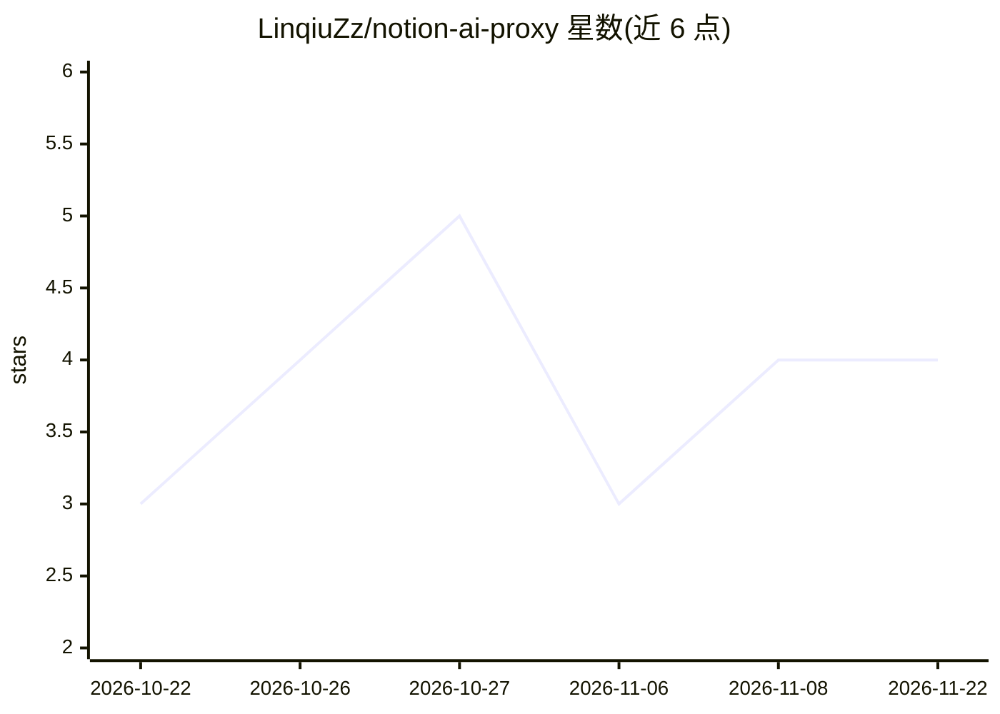

# LinqiuZz/notion-ai-proxy

⭐ 4 · JavaScript · MIT · 推送 2026-10-20 · [GitHub](https://github.com/LinqiuZz/notion-ai-proxy) · 个人维护 · 中文 README

**把 Notion AI 登录态反代成本地 OpenAI 兼容接口的工具**

运行于 Windows 的本机反向代理：以 Edge 浏览器调试端口提取 Notion 网页登录态 cookie，转发 /v1/chat/completions、/v1/messages（Anthropic 协议）等请求到 Notion AI，模型列表从账号动态发现（30+ 个）。单文件 Node 脚本，零 npm 依赖，另提供约 91MB 的打包 exe（免装 Node）。支持流式（伪流式）、联网搜索、图片/PDF 附件；不支持原生 tools/function calling，Cursor Agent 与 Claude Code 的工具能力不可用。README 提示存在风控与账号风险。

## 筛选速览

| 维度 | 判定 | 备注 |
|---|---|---|
| AI 角色 | `ai-ecosystem` | LLM/agent 周边工具 |
| 许可风险 | `permissive` | MIT |
| 部署形态 | `desktop` | 安装包/桌面程序 |
| 模型依赖 | — | README 未给出锁定关系 |
| 硬件要求 | — | 无带数字的原话,不猜 |
| 安装摩擦 | `low` | 无编译、无系统依赖或容器化 |
| 成熟度 | — | 结构信号不足 |

## 能力要点

- 提供 OpenAI / Anthropic / Responses 兼容本地接口，模型列表从 Notion 账号动态发现
- 零 npm 依赖单文件程序，附带免装 Node 的打包 exe（约 91MB，未签名）
- 支持图片/PDF/文本文件附件上传，与 Notion thread 绑定
- 附批量处理脚本与文本协议实现的自动改代码 agent 示例

## 适用场景

- 让支持自定义 OpenAI Base URL 的客户端（Cherry Studio、Cursor 等）使用 Notion AI 内的模型
- 把 Notion AI 接入 Claude Code / Codex CLI 当聊天用
- 批量把目录中的代码/文本文件交给 AI 处理并保存为 Markdown

## 场景标签

`模型网关` · 领域:Agent 开发

## 证据(README 行号)

> L3: 把 **Notion 网页版里的 AI** 变成 **本机可用的 OpenAI 兼容接口**。
> L21: - 提供 OpenAI 兼容接口，把请求转发给 **你自己的 Notion AI 网页登录态**：

## 星数曲线

2026-10-22 3 → 2026-11-22 4（+1）

---
*卡片 v1 · prompt 1.4 · 生成 2026-11-21 · 置信度 mid · 依据 README sha `e42f4b87670d` · [字段定义](../../DATASET.md)*
