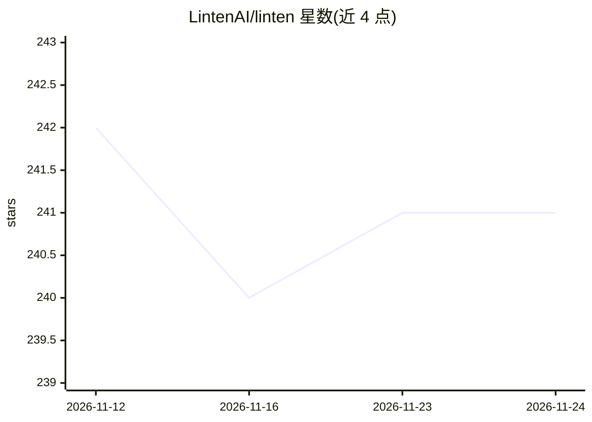

# LintenAI/linten

⭐ 241 · Python · NOASSERTION · 推送 2026-11-16 · [GitHub](https://github.com/LintenAI/linten) · [官网](https://linten.app) · 组织维护

**自托管开源 AI 网关：统一 OpenAI 格式调用 100+ 模型**

开源 AI 网关（代理服务器）加 Python SDK 双形态：以 OpenAI 兼容格式统一调用 100+ LLM 提供商（OpenAI、Anthropic、Gemini、Bedrock、Azure 等），端点覆盖 chat/completions、embeddings、images、audio、batches、rerank 等。网关自带虚拟密钥、支出追踪、负载均衡、护栏与管理面板，支持自动路由选模型、A2A 调用 agent、MCP 工具接入，并可作为 harness 让 Claude Code、Codex 等 agent 的模型调用经过网关。面向 ML 平台团队与开发者，可部署至 Render/Railway/AWS/GCP。限制：来源码构建 linten-core 需 Git、uv 与 Rust 工具链。

## 筛选速览

| 维度 | 判定 | 备注 |
|---|---|---|
| AI 角色 | `ai-ecosystem` | LLM/agent 周边工具 |
| 许可风险 | `none` | NOASSERTION |
| 部署形态 | `self-host` | docker 或自建部署 |
| 模型依赖 | local-ok | 支持本地模型 |
| 硬件要求 | — | 无带数字的原话,不猜 |
| 安装摩擦 | `low` | 无编译、无系统依赖或容器化 |
| 成熟度 | — | 结构信号不足 |

## 能力要点

- 统一 OpenAI 格式接口接入 100+ LLM 提供商
- 虚拟密钥、支出追踪、护栏、负载均衡与管理面板
- A2A agent 调用与 MCP 服务器工具桥接
- Agent Harness 让 Claude Code/Codex 等经过网关调用任意模型

## 适用场景

- 团队搭建集中式 LLM 网关统一管理与计费
- 在代码中切换模型供应商而不改业务代码
- 为编码 agent 统一接入多模型并追踪支出

## 场景标签

`模型网关` · 领域:Agent 开发

## 证据(README 行号)

> L40: Linten is an open source AI Gateway that gives you a single, unified interface to call 100+ LLM providers — OpenAI,
> L42: Use it as a **Python SDK** for direct library integration, or deploy the **AI Gateway (Proxy Server)** as a central
> L53: - **Production-ready gateway** — virtual keys, spend tracking, guardrails, load balancing, and an admin dashboard o

## 星数曲线

2026-11-12 242 → 2026-11-24 241（-1）

---
*卡片 v1 · prompt 1.4 · 生成 2026-11-17 · 置信度 high · 依据 README sha `cdff82ffe9b6` · [字段定义](../../DATASET.md)*
