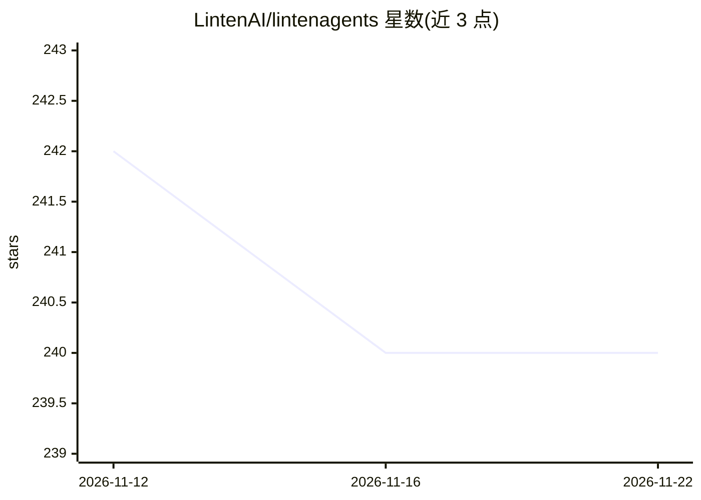

# LintenAI/lintenagents

⭐ 240 · Python · MIT · 推送 2026-11-12 · [GitHub](https://github.com/LintenAI/lintenagents) · [官网](https://linten.app/lintenagent) · 组织维护

**统一 Python SDK，跨 DeepAgents/Pydantic AI/Claude Agent SDK 等切换 agent 框架与模型**

面向 agent 开发者的抽象层 SDK：用同一份应用代码选择 harness（deepagents、pydantic-ai、claude-sdk、codex、opencode-v1/v2 六种）与模型提供方，通过 profile.harness 字段切换框架，SDK 负责配置、工具与 MCP 的协议翻译并规范化输出。支持 OpenAI/Anthropic/Gemini/DeepSeek 等多家模型及本地 Ollama，提供 JSON/YAML 配置、流式对话接口与可选 Temporal 持久化恢复。当前以 GitHub release wheel 发布（v0.3.0a6 预览版，PyPI 名属于其他包），Python 3.11+，OpenCode 需额外 npm 安装。

## 筛选速览

| 维度 | 判定 | 备注 |
|---|---|---|
| AI 角色 | `ai-ecosystem` | LLM/agent 周边工具 |
| 许可风险 | `permissive` | MIT |
| 部署形态 | `library` | 以包/库形式分发 |
| 模型依赖 | local-ok | 支持本地模型 |
| 硬件要求 | — | 无带数字的原话,不猜 |
| 安装摩擦 | `low` | 无编译、无系统依赖或容器化 |
| 成熟度 | `idea` | |

## 能力要点

- 同一份应用代码切换 6 种 harness，仅改 profile.harness
- 类型化 Python 函数工具自动生成 schema 并适配各框架，支持 MCP
- 支持 9+ 模型提供方及 Azure/Bedrock/Vertex/Ollama/网关接入
- 可选 Temporal 持久化：崩溃恢复、重放与幂等操作 ID

## 适用场景

- 在同一代码库中对比多个 agent 框架的运行效果
- 避免锁定单一 agent SDK，随时切换 harness 与模型提供方
- 构建带工具与 MCP、需持久化恢复的 agent 应用

## 场景标签

`Agent 框架` · 领域:Agent 开发

## 证据(README 行号)

> L3: Switch between **DeepAgents, Pydantic AI, Claude Agent SDK, Codex, and OpenCode**

## 星数曲线

2026-11-12 242 → 2026-11-22 240（-2）

---
*卡片 v1 · prompt 1.4 · 生成 2026-11-17 · 置信度 mid · 依据 README sha `07140696b335` · [字段定义](../../DATASET.md)*
