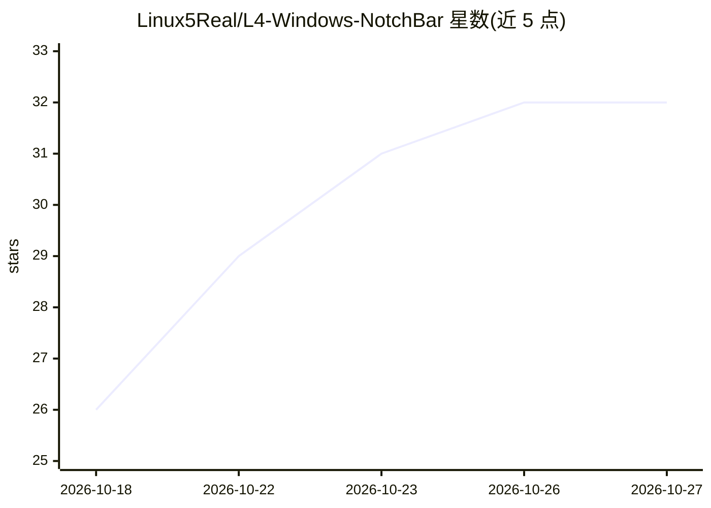

# Linux5Real/L4-Windows-NotchBar

⭐ 32 · TypeScript · GPL-3.0 · 推送 2026-10-09 · [GitHub](https://github.com/Linux5Real/L4-Windows-NotchBar) · 个人维护

**Windows 的 Dynamic Island 式刘海工具栏，聚合快捷工具**

面向 Windows 10/11 消费者的桌面刘海栏应用：屏幕顶部悬停/点击/Ctrl+Alt+Space 展开，内置音乐控制、加密密码与 2FA 保险库（DPAPI 加密、可选 Windows Hello）、天气、剪贴板历史、文件 Shelf、硬件监控（含游戏 FPS）、AI 聊天（Claude/ChatGPT/OpenRouter/OpenAI 兼容端点）与 AI 用量显示。无账户无追踪，数据本地存储。以安装包分发，单一可执行文件几 MB（Tauri 2 + WebView2），开发构建需 Node 22、Rust 与 VS Build Tools。

## 筛选速览

| 维度 | 判定 | 备注 |
|---|---|---|
| AI 角色 | `ai-enhanced` | 去掉 AI 部分产品仍成立 |
| 许可风险 | `viral` | GPL-3.0 |
| 部署形态 | `desktop` | 安装包/桌面程序 |
| 模型依赖 | locked-api |  |
| 硬件要求 | — | 无带数字的原话,不猜 |
| 安装摩擦 | `medium` | 含编译或系统依赖之一 |
| 成熟度 | — | 结构信号不足 |

## 能力要点

- 加密密码/2FA 保险库（Windows DPAPI，可选 Windows Hello + TPM 密钥）
- AI 聊天支持 Claude、ChatGPT、OpenRouter 及 OpenAI 兼容自定义端点
- 游戏 FPS/硬件实时监控（DirectX/OpenGL/Vulkan）
- 本地数据、无账户无分析，密钥存 Windows Credential Manager

## 适用场景

- 在 Windows 上获得类似 Dynamic Island 的快捷工具入口
- 集中管理密码、2FA 码与剪贴板历史
- 不切换窗口查看当前播放、天气、通话与 AI 用量

## 场景标签

`聊天机器人` · 领域:对话与助手

## 证据(README 行号)

> L19: Inside: music controls with a live equalizer, a vault for passwords and 2FA codes, live weather, your Discord call,
> L21: Make it yours: reorder or hide any tool, move the notch, pick the monitor, hide it automatically in fullscreen apps
> L40: - **Ask** is a chat with Claude, ChatGPT, OpenRouter or any OpenAI-compatible endpoint, with streaming and adjustab

## 星数曲线

2026-10-18 26 → 2026-10-27 32（+6）

---
*卡片 v1 · prompt 1.4 · 生成 2026-10-26 · 置信度 mid · 依据 README sha `13bbb4cdb135` · [字段定义](../../DATASET.md)*
