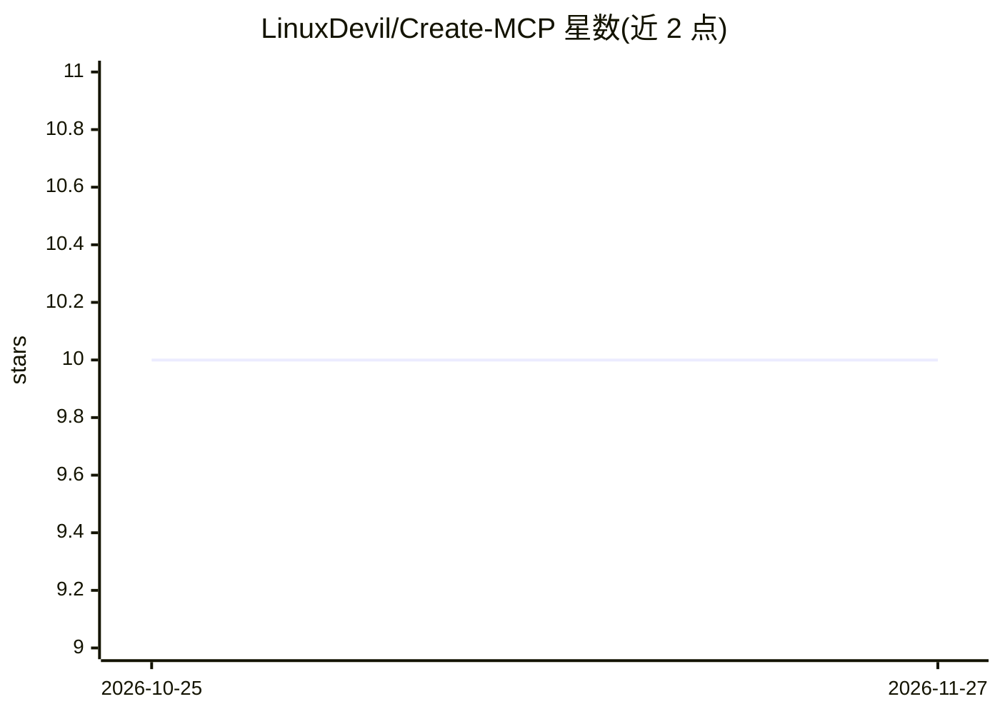

# LinuxDevil/Create-MCP

⭐ 10 · TypeScript · MIT · 推送 2026-08-10 · [GitHub](https://github.com/LinuxDevil/Create-MCP) · [官网](https://mcp-server-generator.com) · 个人维护

**生成生产级 MCP 服务器的脚手架 CLI 工具**

一个 npm 发布的 CLI 工具（mcp-server-generator），用于生成和扩展 Model Context Protocol 服务器项目。生成单一统一的 Data Analysis Assistant 示例，覆盖工具、资源、提示、 elicitation 等全部 MCP 能力，支持 stdio/HTTP/Streamable HTTP 传输，内置 MCP Inspector 测试脚本；提供 add/list 命令向已有项目添加 tool、resource、prompt、service、transport、util 六类组件并自动注册、备份回滚。面向学习 MCP 开发与构建生产服务器的开发者，生成 TypeScript 项目，依赖官方 MCP SDK、zod、express 等。

## 筛选速览

| 维度 | 判定 | 备注 |
|---|---|---|
| AI 角色 | `ai-ecosystem` | LLM/agent 周边工具 |
| 许可风险 | `permissive` | MIT |
| 部署形态 | `library` | 以包/库形式分发 |
| 模型依赖 | — | README 未给出锁定关系 |
| 硬件要求 | — | 无带数字的原话,不猜 |
| 安装摩擦 | `low` | 无编译、无系统依赖或容器化 |
| 成熟度 | — | 结构信号不足 |

## 能力要点

- npx 一条命令生成完整 MCP 服务器项目（npm 包 mcp-server-generator）
- add 命令向现有项目扩展 6 类组件，含自动注册、备份回滚与冲突校验
- 支持 stdio、HTTP、Streamable HTTP 三种传输与 OAuth/DNS 保护选项
- 内置 MCP Inspector 集成测试（可视化与 CLI 模式）

## 适用场景

- 快速创建一个展示全部 MCP 能力的示例服务器来学习 MCP 开发
- 为自建工具生成可直接接入 Claude Desktop 等 MCP 客户端的服务器
- 在已有 MCP 项目中添加新的 tool/prompt/service 组件

## 场景标签

`代码生成` · 领域:编码与开发

## 证据(README 行号)

> L3: A modern CLI tool for generating and extending production-ready Model Context Protocol (MCP) servers. Built with cle
> L49: - ➕ **Component Extension**: Add tools, resources, prompts, services, transports, and utils to existing projects

## 星数曲线

2026-10-25 10 → 2026-11-27 10（+0）

---
*卡片 v1 · prompt 1.4 · 生成 2026-11-20 · 置信度 high · 依据 README sha `e9ca46066951` · [字段定义](../../DATASET.md)*
