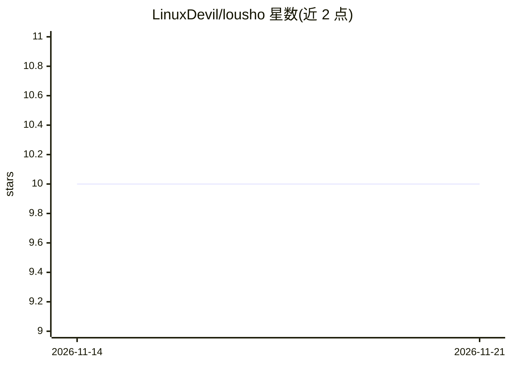

# LinuxDevil/lousho

⭐ 10 · TypeScript · MIT · 推送 2026-11-19 · [GitHub](https://github.com/LinuxDevil/lousho) · [官网](https://lousho.com) · 个人维护

**TypeScript AI agent SDK：离线评测、可恢复运行、人工审批与 MCP**

面向 TypeScript 开发者的 agent 构建框架，运行在用户自己的 Node 进程中，不依赖托管运行时。关键机制包括：lousho eval 录制真实运行并在 CI 中离线回放以检测工具调用轨迹漂移；配合持久化存储（内存/文件/SQLite/Cloudflare KV）通过 agent.resume() 在崩溃后继续运行；needsApproval 工具可暂停等待人工审批。支持 MCP 接入与对外提供服务、多 agent 并行与任务移交，提供 React/Vue/Svelte UI 绑定与 OpenTelemetry 追踪。README 声明当前为 Alpha 阶段，API 可能变动。

## 筛选速览

| 维度 | 判定 | 备注 |
|---|---|---|
| AI 角色 | `ai-ecosystem` | LLM/agent 周边工具 |
| 许可风险 | `permissive` | MIT |
| 部署形态 | `library` | 以包/库形式分发 |
| 模型依赖 | — | README 未给出锁定关系 |
| 硬件要求 | — | 无带数字的原话,不猜 |
| 安装摩擦 | `low` | 无编译、无系统依赖或容器化 |
| 成熟度 | `idea` | |

## 能力要点

- 离线 CI 评测：录制一次真实运行，回放无需网络与 API key，支持漂移检测
- 持久化执行：崩溃后 agent.resume() 恢复运行，已完成工具调用不重复执行
- 人工审批：needsApproval 标记的工具可跨进程审批后继续
- 支持 MCP：可连接 MCP 服务器或将 agent 作为 MCP 服务提供

## 适用场景

- 在没有 API key 的 CI 环境中回归测试 agent 的工具调用轨迹
- 构建需要崩溃恢复和跨进程人工审批的长时 agent 任务
- 从 Vercel AI SDK 逐步迁移现有 agent 代码
- 开发可连接或提供 MCP 服务的多 agent 系统

## 场景标签

`Agent 框架` `多智能体` `模型评测` · 领域:Agent 开发

## 证据(README 行号)

> L7: # Lousho — TypeScript AI agent SDK
> L30: - **Test agents in CI without an API key.** `lousho eval` records a real run once, replays it with no network, and 
> L33: - **Runs in your own Node process.** There is no hosted runtime. `lousho build` targets a Node server, Docker or Cl

## 星数曲线

2026-11-14 10 → 2026-11-21 10（+0）

---
*卡片 v1 · prompt 1.4 · 生成 2026-11-20 · 置信度 high · 依据 README sha `d0a5a79fad42` · [字段定义](../../DATASET.md)*
