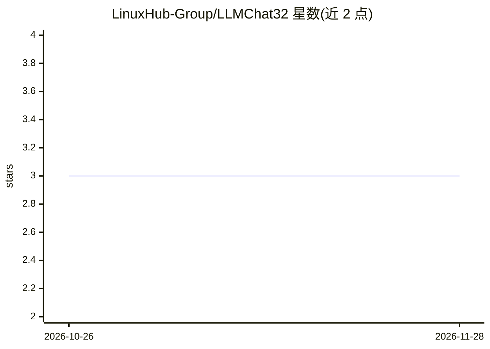

# LinuxHub-Group/LLMChat32

⭐ 3 · C · 推送 2026-10-20 · [GitHub](https://github.com/LinuxHub-Group/LLMChat32) · 个人维护 · 中文 README

**Windows 98 可直连 Anthropic/OpenAI 的 LLM 聊天客户端**

以 C89 编写、Open Watcom 2.0 构建的 Win32 聊天客户端，自绘 GDI 界面，静态链接 wolfSSL 以在 Windows 98 上原生完成 TLS 1.2/1.3 握手，无需额外代理程序即可直连 LLM API。支持三种协议（Anthropic Messages / OpenAI Chat Completions / OpenAI Responses）、SSE 流式输出、多会话 tab 与 JSON 历史落盘恢复、TOML 多模型配置与可选 HTTP CONNECT 代理，提供中英双语界面。限制：需自备 Open Watcom portable 快照从源码构建，未提供预编译产物。

## 筛选速览

| 维度 | 判定 | 备注 |
|---|---|---|
| AI 角色 | `ai-ecosystem` | LLM/agent 周边工具 |
| 许可风险 | `none` | — |
| 部署形态 | `desktop` | 安装包/桌面程序 |
| 模型依赖 | — | README 未给出锁定关系 |
| 硬件要求 | — | 无带数字的原话,不猜 |
| 安装摩擦 | `low` | 无编译、无系统依赖或容器化 |
| 成熟度 | — | 结构信号不足 |

## 能力要点

- 内置 wolfSSL 静态链接，Windows 98 上直接完成 TLS 1.2/1.3 握手
- 三套 LLM 协议：Anthropic Messages / OpenAI Chat Completions / OpenAI Responses
- SSE 流式接收、多会话 tab、JSON 历史落盘并支持重启恢复
- 中英双语界面，按系统语言自动选择

## 适用场景

- 在 Windows 98 真机上直接与 Claude/GPT 类模型对话
- 怀旧硬件环境下运行原生 Win32 LLM 客户端
- 需要逐模型控制流式输出与推理等级参数的多会话聊天

## 场景标签

`聊天机器人` · 领域:对话与助手

## 证据(README 行号)

> L3: Windows 98 兼容的 LLM 聊天客户端：Win32 + 自绘 GDI 界面，C89 编写，Open Watcom 2.0 构建，wolfSSL 静态链接（TLS 1.3 实测握手通过）。
> L20: - 三套 LLM 协议：Anthropic Messages / OpenAI Chat Completions / OpenAI Responses

## 星数曲线

2026-10-26 3 → 2026-11-28 3（+0）

---
*卡片 v1 · prompt 1.4 · 生成 2026-11-22 · 置信度 high · 依据 README sha `7e038fd67365` · [字段定义](../../DATASET.md)*
