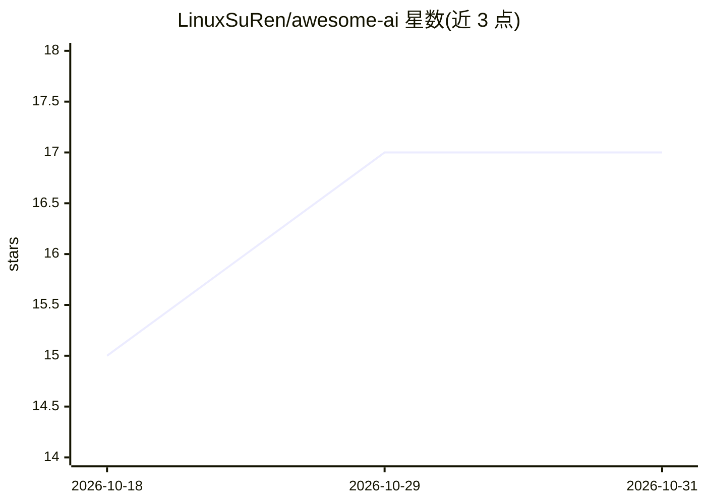

# LinuxSuRen/awesome-ai

⭐ 17 · Apache-2.0 · 推送 2026-10-28 · [GitHub](https://github.com/LinuxSuRen/awesome-ai) · [官网](https://linuxsuren.github.io/awesome-ai/) · 个人维护 · 中文 README

**AI 工具分类收录清单：对话、编程、开发、图像生成等 82+ 条**

由个人维护的 AI 工具聚合清单，按 8 个分类组织条目：Chatbot（12）、CodeAssistant（5）、Develop Tool（21）、Local（2）、Other（26）、Search（5）、Search Engine（3）、Text to Image（8）。每条目仅列名称与创作者，指向对话助手、编程助手、本地部署（如 Ollama）、文生图等外部工具。README 由模板经 yaml-readme 自动生成，贡献者需在 data 目录新增 YAML 文件，由 generator workflow 重新生成，不可直接编辑 README。

## 筛选速览

| 维度 | 判定 | 备注 |
|---|---|---|
| AI 角色 | `ai-knowledge` | 知识聚合/清单类 |
| 许可风险 | `permissive` | Apache-2.0 |
| 部署形态 | `None` |  |
| 模型依赖 | — | README 未给出锁定关系 |
| 硬件要求 | — | 无带数字的原话,不猜 |
| 安装摩擦 | `low` | 无编译、无系统依赖或容器化 |
| 成熟度 | — | 结构信号不足 |

## 能力要点

- 8 个分类组织 80+ 条 AI 工具条目
- 收录本地部署方案（Ollama 等）与文生图工具
- YAML 数据驱动，README 由 generator workflow 自动生成

## 适用场景

- 浏览各分类下的 AI 工具并发现新工具
- 查找本地部署或特定类别（如文生图、编程助手）的 AI 服务

## 场景标签

`精选清单` · 领域:学习与行业

## 证据(README 行号)

> L5: **精选优质 AI 工具收录：对话助手、编程助手、开发工具、图像生成……持续更新**
> L15: ## 💬 Chatbot(12)

## 星数曲线

2026-10-18 15 → 2026-10-31 17（+2）

---
*卡片 v1 · prompt 1.4 · 生成 2026-10-30 · 置信度 high · 依据 README sha `2a3f6810091f` · [字段定义](../../DATASET.md)*
