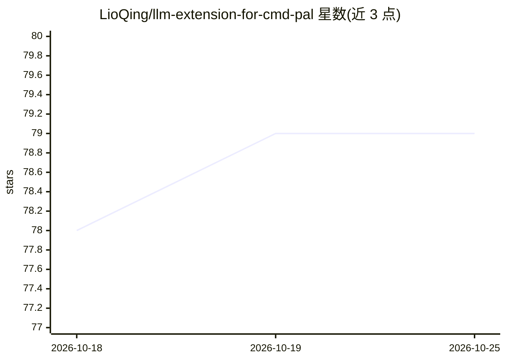

# LioQing/llm-extension-for-cmd-pal

⭐ 79 · C# · MIT · 推送 2026-07-20 · [GitHub](https://github.com/LioQing/llm-extension-for-cmd-pal) · [官网](http://lioqing.com/llm-extension-for-cmd-pal/) · 个人维护

**在 PowerToys 命令面板中直接对话 LLM 的扩展**

面向 Windows PowerToys Command Palette 的扩展，用户在命令面板内即可与大语言模型对话。支持多种 API 提供方：Ollama、OpenAI 及其兼容 API（如 Docker Model Runner）、Azure OpenAI、Google、Mistral。安装途径包括命令面板内搜索安装、WinGet、Microsoft Store 与 GitHub Releases 发布包，并提供 YouTube 配置教程播放列表。

## 筛选速览

| 维度 | 判定 | 备注 |
|---|---|---|
| AI 角色 | `ai-native` | 本体是模型或模型工具 |
| 许可风险 | `permissive` | MIT |
| 部署形态 | `desktop` | 安装包/桌面程序 |
| 模型依赖 | local-ok | 支持本地模型 |
| 硬件要求 | — | 无带数字的原话,不猜 |
| 安装摩擦 | `low` | 无编译、无系统依赖或容器化 |
| 成熟度 | — | 结构信号不足 |

## 能力要点

- 在 Command Palette 内直接进行 LLM 对话
- 支持 Ollama/OpenAI 兼容 API/Azure OpenAI/Google/Mistral
- 四种安装途径：面板内安装、WinGet、Microsoft Store、GitHub Releases

## 适用场景

- Windows 用户不切换窗口快速向 LLM 提问
- 通过本地 Ollama 在命令面板中使用本地模型
- 在命令面板中切换使用多家 API 服务

## 场景标签

`聊天机器人` · 领域:对话与助手

## 证据(README 行号)

> L3:  This is an extension for PowerToys Command Palette that allows you to chat with a large language model (LLM) direct
> L12: It currently supports the following APIs:

## 星数曲线

2026-10-18 78 → 2026-10-25 79（+1）

---
*卡片 v1 · prompt 1.4 · 生成 2026-10-24 · 置信度 high · 依据 README sha `a01feb7893e3` · [字段定义](../../DATASET.md)*
