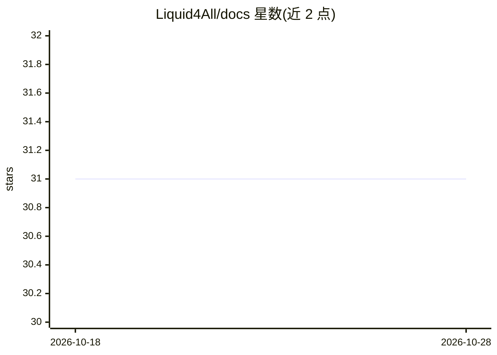

# Liquid4All/docs

⭐ 31 · MDX · NOASSERTION · 推送 2026-10-28 · [GitHub](https://github.com/Liquid4All/docs) · [官网](https://docs.liquid.ai) · 组织维护

**Liquid AI 官方文档仓库：LFM 模型开发指南与 MCP 接入**

Liquid AI 的官方文档仓库，收录围绕开放权重 LFM 模型在笔记本、移动与边缘设备上构建应用的指南、API 参考与教程，托管于 docs.liquid.ai。文档站点提供 MCP 服务器（https://docs.liquid.ai/mcp），可供 Claude Code、Cursor 等 AI 编码工具实时查询文档内容。文档基于 Mintlify 构建，需 Node.js 环境，通过 npm 安装 CLI 后本地运行；内置链接检查与 append-only 的 URL 快照机制保障链接可解析。文档以 CC BY-SA 4.0 许可发布。

## 筛选速览

| 维度 | 判定 | 备注 |
|---|---|---|
| AI 角色 | `ai-knowledge` | 知识聚合/清单类 |
| 许可风险 | `none` | NOASSERTION |
| 部署形态 | `library` | 以包/库形式分发 |
| 模型依赖 | — | README 未给出锁定关系 |
| 硬件要求 | — | 无带数字的原话,不猜 |
| 安装摩擦 | `low` | 无编译、无系统依赖或容器化 |
| 成熟度 | — | 结构信号不足 |

## 能力要点

- 覆盖开放权重 LFM 模型在笔记本/移动/边缘设备的使用指南、API 参考与教程
- 托管 MCP 服务器，供 AI 编码工具实时查询文档
- 基于 Mintlify 构建，支持本地开发服务器与自动重载
- append-only 的 URL 快照机制与 CI 链接校验

## 适用场景

- 查阅 LFM 模型在边缘设备上的部署与 API 用法
- 把 Liquid 文档接入 Claude Code 或 Cursor 作为实时知识源
- 参与贡献或本地预览 Liquid AI 文档

## 场景标签

`教程课程` · 领域:学习与行业

## 证据(README 行号)

> L12: This is the **official documentation repository** for Liquid AI. It contains comprehensive guides, API references, 
> L20: The Model Context Protocol (MCP) is an open standard that gives AI applications a standardized way to connect to ex

## 星数曲线

2026-10-18 31 → 2026-10-28 31（+0）

---
*卡片 v1 · prompt 1.4 · 生成 2026-10-26 · 置信度 high · 依据 README sha `09501364fa8d` · [字段定义](../../DATASET.md)*
