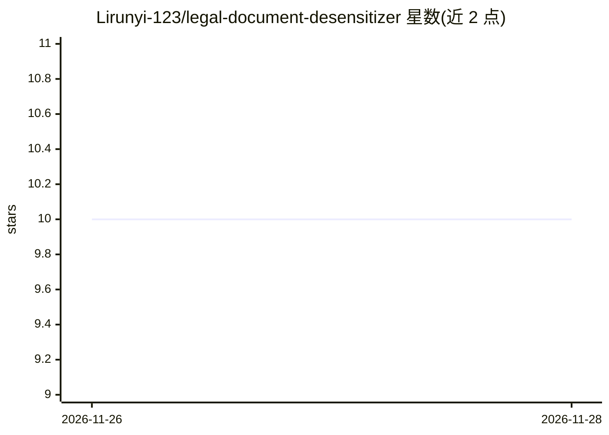

# Lirunyi-123/legal-document-desensitizer

⭐ 10 · Python · 推送 2026-09-01 · [GitHub](https://github.com/Lirunyi-123/legal-document-desensitizer) · 个人维护 · 中文 README

**面向中国律师的法律文书本地脱敏与可还原工具**

以规则引擎为主、实体归一化与可选 NER/LLM 语义层为辅的两阶段脱敏工具：将判决书、合同、银行流水中 20+ 类中国法律实体（GB 11643 身份证、GB 32100 信用代码、案号等）替换为语义占位符，映射表经 AES-256-GCM 加密后可一键逐字节还原。支持 docx/pdf/xlsx/图片输入、PDF 字符级涂黑、macOS Vision 本地 OCR、批量卷宗与跨文件身份归一，并输出审计单与律师签发流程；明确列出手写体、印章、二维码、水印等不支持的边界。

## 筛选速览

| 维度 | 判定 | 备注 |
|---|---|---|
| AI 角色 | `ai-native` | 本体是模型或模型工具 |
| 许可风险 | `none` | — |
| 部署形态 | `library` | 以包/库形式分发 |
| 模型依赖 | local-ok | 支持本地模型 |
| 硬件要求 | — | 无带数字的原话,不猜 |
| 安装摩擦 | `medium` | 含编译或系统依赖之一 |
| 成熟度 | — | 结构信号不足 |

## 能力要点

- 20+ 类中国法律实体识别，含国标校验码（GB 11643/GB 32100/Luhn）
- AES-256-GCM 加密映射表，restore 一键无损还原
- 规则层本地正则零联网，LLM 层可选本地 Ollama 或云端 API（v5.3 起非本机端点须显式授权）
- 红队评测 105 个实体用例，附 entity-level P/R/F1 评测脚本

## 适用场景

- 判决书、合同等文书交给 AI 前先脱敏并签发
- 批量卷宗中同一当事人统一匿名身份
- 扫描件 OCR 后涂黑输出保留原版式 PDF
- 银行流水中按列识别并脱敏户名/账号

## 场景标签

`文档解析` · 领域:知识与检索

## 证据(README 行号)

> L3: 面向中国法律实务的**本地优先**文书脱敏工具：判决书、合同、聊天记录、证据材料中的
> L7: > 规则引擎 + 实体归一化 + 可选本地 NER / LLM，**离线可跑、全文实体一致、可审计还原**。
> L148: |**本地 NER（可选）**|规则层覆盖不到的人名/公司/地址|spaCy / HuggingFace / Ollama|

## 星数曲线

2026-11-26 10 → 2026-11-28 10（+0）

---
*卡片 v1 · prompt 1.4 · 生成 2026-11-26 · 置信度 mid · 依据 README sha `549246ee7a63` · [字段定义](../../DATASET.md)*
