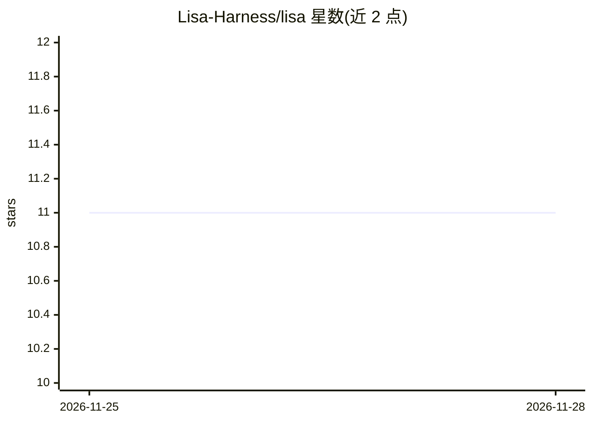

# Lisa-Harness/lisa

⭐ 11 · Python · MIT · 推送 2026-11-24 · [GitHub](https://github.com/Lisa-Harness/lisa) · [官网](https://migus.org/lisa) · 组织维护

**模块化 AI agent 运行时与 MCP 宿主框架**

Lisa 是一个可组合、可扩展的模块化 AI agent 运行时与宿主：提供可检查的工具启用回合循环、意图驱动的模式切换、事件驱动的模型路由、读写与执行的审批策略，以及包含 pack 加载器的 SDK。宿主负责用户界面与通信传输、管理 MCP 服务器与模型代理，并从 pack 加载模式、操作、代理、服务器与工具。框架分层为 kernel、SDK、runtime、MCP 服务器等多个独立分发包，经 PyPI 发布，MIT 许可，要求 Python 3.11+。

## 筛选速览

| 维度 | 判定 | 备注 |
|---|---|---|
| AI 角色 | `ai-ecosystem` | LLM/agent 周边工具 |
| 许可风险 | `permissive` | MIT |
| 部署形态 | `library` | 以包/库形式分发 |
| 模型依赖 | — | README 未给出锁定关系 |
| 硬件要求 | — | 无带数字的原话,不猜 |
| 安装摩擦 | `low` | 无编译、无系统依赖或容器化 |
| 成熟度 | — | 结构信号不足 |

## 能力要点

- 可检查的工具启用回合循环与审批策略（/approve 恢复暂停调用）
- 意图驱动的模式切换与事件驱动的 CEL 模型路由（可选）
- MCP 原生：宿主管理 MCP 服务器，pack 通过 entry points 贡献模式、工具与 MCP 服务器
- 分层架构拆分为 10 个框架分发包，全部经 PyPI 发布

## 适用场景

- 基于该运行时构建自己的 agent 宿主与通信传输层
- 编写 pack 为 agent 扩展模式、工具与 MCP 服务器
- 通过审批策略与效果回执管控 agent 的实际副作用调用

## 场景标签

`Agent 框架` · 领域:Agent 开发

## 证据(README 行号)

> L7: Lisa is an composable, extensible and modular AI agent runtime and host.
> L14: and an SDK that includes a "pack" loader.
> L17: manages the MCP servers and model proxies,

## 星数曲线

2026-11-25 11 → 2026-11-28 11（+0）

---
*卡片 v1 · prompt 1.4 · 生成 2026-11-24 · 置信度 high · 依据 README sha `584261d1f021` · [字段定义](../../DATASET.md)*
