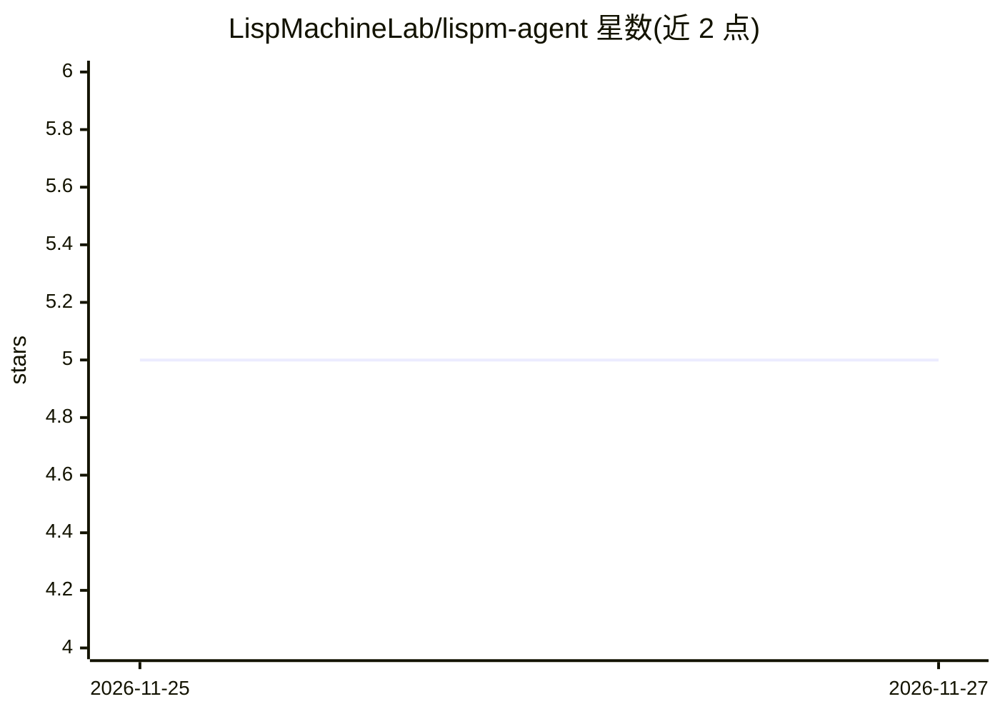

# LispMachineLab/lispm-agent

⭐ — · [GitHub]() · 组织维护

**在 GNU Emacs 内运行 AI agent 的 agent harness**

以 Emacs 为运行环境的 agent harness：对话即 org 文档（同时充当模型上下文），工具为 Elisp 函数，工具调用是 TODO 条目、通过改变其状态进行审批，记忆存放在 git 管理的 org 文件中，agent 由 hook 唤醒并可相互委托。提供聊天界面、系统级 LispM bar、终端界面、会话恢复、diff 审查与回退、权限策略等机制。需要 Emacs 30.1+、curl 和一个 OpenAI Chat Completions 或 Anthropic Messages 端点背后的模型。

## 筛选速览

| 维度 | 判定 | 备注 |
|---|---|---|
| AI 角色 | `ai-ecosystem` | LLM/agent 周边工具 |
| 许可风险 | `viral` | — |
| 部署形态 | `None` |  |
| 模型依赖 | locked-api |  |
| 硬件要求 | — | 无带数字的原话,不猜 |
| 安装摩擦 | `medium` | 含编译或系统依赖之一 |
| 成熟度 | — | 结构信号不足 |

## 能力要点

- 对话为 org 文档并直接作为模型上下文，工具调用以 TODO 状态实现审批
- 记忆置于 git 仓库：会话、任务与角色记忆，超长对话自动压缩为摘要
- 按 read/write/shell/exec/web/mcp 分类的权限策略，可按角色覆盖
- LispM bar、终端界面、dashboard 与会话恢复等系统级界面

## 适用场景

- 在 Emacs 项目中运行可审批、可回退的编码 agent
- 把 agent 的会话、记忆与任务以 org+git 形式长期管理
- 在文本终端或远程 TRAMP 目录中驱动 agent 工作

## 场景标签

`编码 Agent` `Agent 框架` · 领域:Agent 开发

## 证据(README 行号)

> L7: AI agents that run inside Emacs rather than beside it. You chat with an agent as in Claude
> L28: Emacs 30.1+, curl, and a model behind an OpenAI Chat Completions or Anthropic Messages
> L163: - *Roles, agents, sessions.* A role is instructions, tools, policy and model: ~lispm-defrole~,

## 星数曲线

2026-11-25 5 → 2026-11-27 5（+0）

---
*卡片 v1 · prompt 1.4 · 生成 2026-11-24 · 置信度 high · 依据 README sha `dd2f8f2a516a` · [字段定义](../../DATASET.md)*
