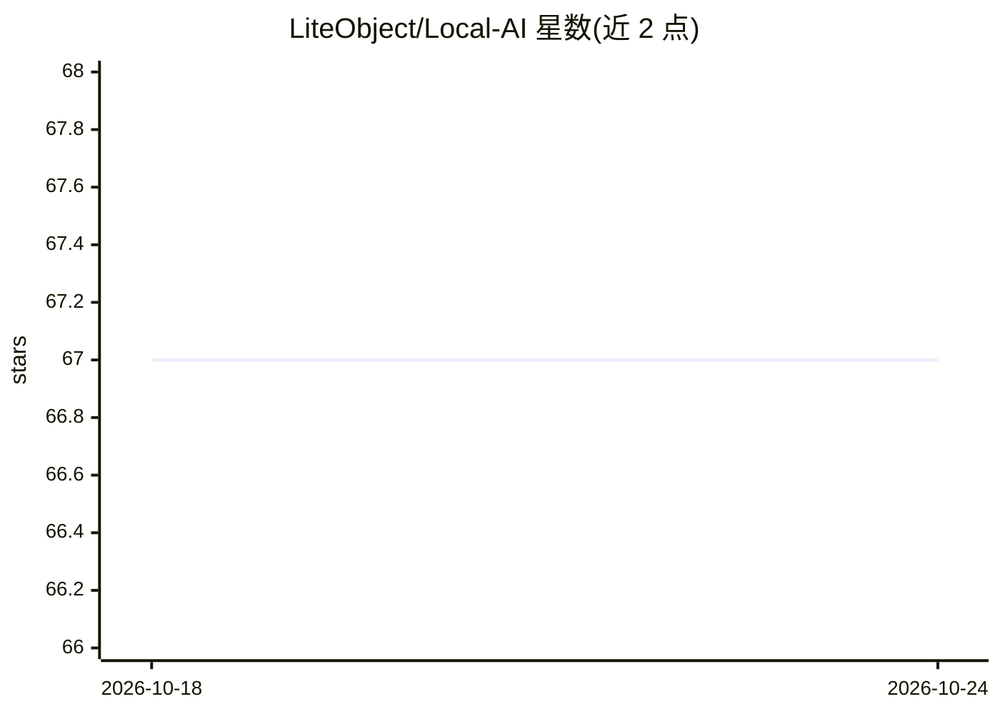

# LiteObject/Local-AI

⭐ 67 · 推送 2026-08-01 · [GitHub](https://github.com/LiteObject/Local-AI) · 个人维护

**本地运行 LLM 的入门教程：选工具、查硬件、装模型**

面向普通用户的本地大模型运行指南：介绍 LM Studio 与 Ollama 两类工具的安装使用，给出按 VRAM 分档的模型选择表（覆盖 qwen3.5、gemma、granite、gpt-oss 等），说明 GPU 兼容范围（NVIDIA/Apple Silicon/AMD/Intel Vulkan）、部分 CPU 卸载时的性能表现与排查方法，并附常见问题与进阶文档索引。本体为文档仓库，不提供可安装的软件。

## 筛选速览

| 维度 | 判定 | 备注 |
|---|---|---|
| AI 角色 | `ai-knowledge` | 知识聚合/清单类 |
| 许可风险 | `none` | — |
| 部署形态 | `None` |  |
| 模型依赖 | — | README 未给出锁定关系 |
| 硬件要求 | — | 无带数字的原话,不猜 |
| 安装摩擦 | `low` | 无编译、无系统依赖或容器化 |
| 成熟度 | — | 结构信号不足 |

## 能力要点

- 按 VRAM 分档（8GB–32GB+）的模型选择表与下载体积对照
- GPU 兼容清单：NVIDIA 计算能力 5.0+、Apple Silicon、AMD ROCm/Vulkan
- Ollama 常用命令与 PROCESSOR 列 GPU/CPU 卸载排查方法
- 常见安装与运行问题（内存不足、推理延迟、杀毒软件拦截）排查条目

## 适用场景

- 从零开始在本机安装并运行第一个本地 LLM
- 按自己电脑的显存/内存挑选合适的量化模型
- 排查模型运行慢或内存不足的问题

## 场景标签

`教程课程` · 领域:学习与行业

## 证据(README 行号)

> L7: Tired of paying a monthly subscription for a chatbot? Yeah, me too. Here's how to run these AI models on your own ma
> L20: ## Step 1: Choose the Best Local AI Software (LM Studio vs Ollama)
> L102: ## Step 3: Download and Install Your First AI Model

## 星数曲线

2026-10-18 67 → 2026-10-24 67（+0）

---
*卡片 v1 · prompt 1.4 · 生成 2026-10-24 · 置信度 high · 依据 README sha `8450b3de0774` · [字段定义](../../DATASET.md)*
