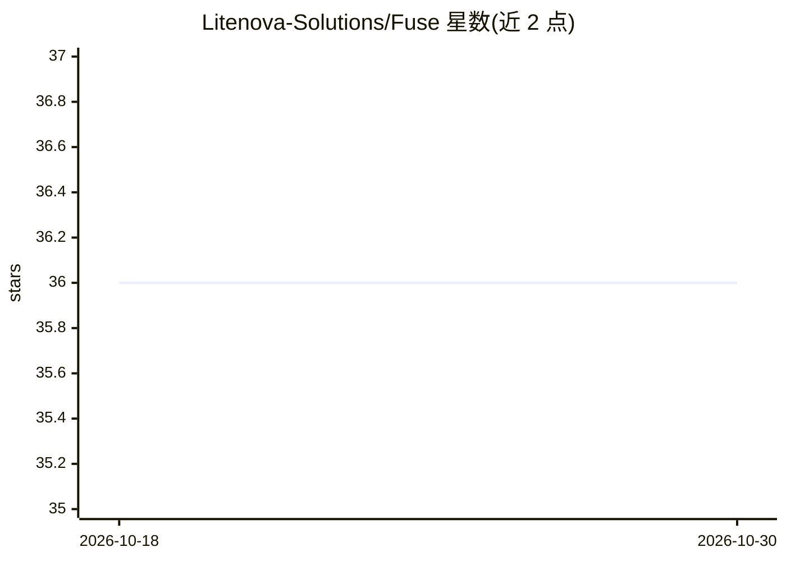

# Litenova-Solutions/Fuse

⭐ 36 · C# · Apache-2.0 · 推送 2026-10-29 · [GitHub](https://github.com/Litenova-Solutions/Fuse) · [官网](https://fuse.codes) · 组织维护

**为 AI 编程 agent 加速 .NET 构建与测试反馈的工具**

面向使用 Claude Code、Cursor、Codex 等 agent 的 .NET 开发流程的工具：常驻后台加载解决方案，每次编辑后以 hooks 或 MCP server 形式向 agent 报告新引入的编译错误与受影响的失败测试，替代逐次运行的 dotnet build/test，并限制输出条数。支持八种 agent harness、多个子 agent 共享一个引擎进程按序检查。要求 .NET 10 SDK 与已有 git 提交，内存占用 339MB–1.7GB 级，仅检查 C#，部分场景仍需 fuse build/test --all。通过 dotnet tool 全局安装，fuse init 一条命令完成接入。

## 筛选速览

| 维度 | 判定 | 备注 |
|---|---|---|
| AI 角色 | `ai-ecosystem` | LLM/agent 周边工具 |
| 许可风险 | `permissive` | Apache-2.0 |
| 部署形态 | `None` |  |
| 模型依赖 | — | README 未给出锁定关系 |
| 硬件要求 | — | 无带数字的原话,不猜 |
| 安装摩擦 | `medium` | 含编译或系统依赖之一 |
| 成熟度 | — | 结构信号不足 |

## 能力要点

- 编辑后仅报告新引入的编译错误，基准中快于 dotnet build
- 跨项目列出被破坏的调用方，只运行受影响的测试
- 支持 Claude Code/Cursor/Codex/Gemini CLI 等 8 种 harness（Hooks/插件/MCP）
- 多 agent 共享一个引擎进程，并行构建不因文件锁失败

## 适用场景

- 让 AI 编程 agent 在 .NET 项目中更快自查编译错误与测试结果
- 多子 agent 并行工作时避免重复加载解决方案与文件锁冲突
- 控制 agent 收到的构建输出长度，减少无关信息

## 场景标签

 · 领域:软件开发工具/.NET

## 证据(README 行号)

> L9: Faster .NET build and test loop for AI coding agents.
> L13: Fuse fixes that. It keeps your solution loaded in the background, and after each edit it tells the agent:
> L43: |Harness|Integration|
> L110: |`fuse mcp`|Serves `fuse_check`, `fuse_test` and `fuse_build` over stdio to an MCP host|

## 星数曲线

2026-10-18 36 → 2026-10-30 36（+0）

---
*卡片 v1 · prompt 1.4 · 生成 2026-10-25 · 置信度 high · 依据 README sha `2b651803d56e` · [字段定义](../../DATASET.md)*
