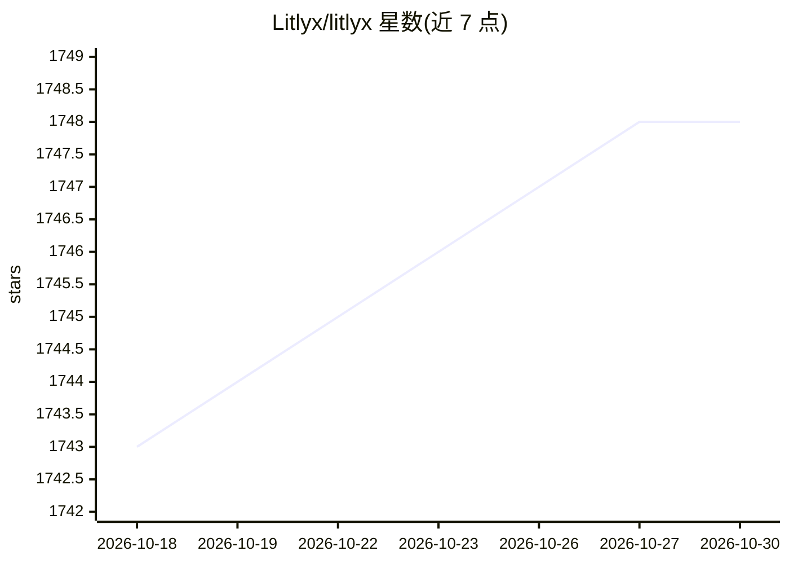

# Litlyx/litlyx

⭐ 1,748 · TypeScript · Apache-2.0 · 推送 2025-12-03 · [GitHub](https://github.com/Litlyx/litlyx) · [官网](https://litlyx.com) · 组织维护

**面向网站的 Cookie-free 自托管分析工具**

Litlyx 是一个网站访问分析工具：通过 script 标签或 npm 包接入，自动追踪页面访问、实时用户与独立访客，支持自定义事件与 metadata，也可用 cURL 直接发送事件。提供托管云版本与 Docker 自托管两种方式，自托管通过 npm run docker-prepare 与 docker-compose 启动仪表盘，数据可转发到自托管实例。描述中称仪表盘带 AI 功能，README 正文未展开细节；自称可替代 Google Analytics 4、Posthog 和 Mixpanel。采用 Apache 2.0 许可，提供商业版终身套餐（更多客户端席位）。

## 筛选速览

| 维度 | 判定 | 备注 |
|---|---|---|
| AI 角色 | `ai-enhanced` | 去掉 AI 部分产品仍成立 |
| 许可风险 | `permissive` | Apache-2.0 |
| 部署形态 | `self-host` | docker 或自建部署 |
| 模型依赖 | — | README 未给出锁定关系 |
| 硬件要求 | — | 无带数字的原话,不猜 |
| 安装摩擦 | `low` | 无编译、无系统依赖或容器化 |
| 成熟度 | — | 结构信号不足 |

## 能力要点

- script 标签一行接入，无 Cookie，自动追踪访问/实时用户/独立访客
- 自定义事件与 metadata 追踪，支持 cURL 直发事件
- Docker 自托管，数据可经 data-host/data-port 转发到自有实例
- 兼容各类 JavaScript/TypeScript 框架与 WordPress

## 适用场景

- 给网站或 Web 应用接入访问统计与事件分析
- 用 Docker 在自己的服务器上托管分析仪表盘
- 替换现有分析服务并保持数据自主（GDPR 合规）

## 场景标签

 · 领域:网站分析/数据可视化

## 证据(README 行号)

> L5:  Litlys is the easiest analytics tool you will ever use. It is fast, modern and completely cookie free.
> L20: 

## 星数曲线

2026-10-18 1,743 → 2026-10-30 1,748（+5）

---
*卡片 v1 · prompt 1.4 · 生成 2026-10-21 · 置信度 mid · 依据 README sha `a08ccbeae0a4` · [字段定义](../../DATASET.md)*
